# Zen Source Viewer — User Guide

Zen Source Viewer shows the source code of Firefox and Thunderbird add-ons
without installing them. You can read, search and edit the code, compare two
versions, check translations, review permissions and risky code, and keep
review notes. Everything runs in your browser; files you open stay on your
computer.

The red numbers in the screenshots show what to click. The screenshots use
uBlock Origin as an example.

## Contents

- [What each feature is for](#what-each-feature-is-for)

1. [Opening an add-on](#1-opening-an-add-on)
2. [The viewer](#2-the-viewer)
3. [Reading code](#3-reading-code)
4. [Searching](#4-searching)
5. [File analysis and links](#5-file-analysis-and-links)
6. [Editing and the Changes panel](#6-editing-and-the-changes-panel)
7. [Files and folders](#7-files-and-folders)
8. [Patches](#8-patches)
9. [Comparing two versions](#9-comparing-two-versions)
10. [Locales and translations](#10-locales-and-translations)
11. [APIs](#11-apis)
12. [Review report](#12-review-report)
13. [Review notes](#13-review-notes)
14. [Quick open, symbols and tabs](#14-quick-open-symbols-and-tabs)
15. [Keyboard shortcuts](#15-keyboard-shortcuts)
16. [Settings](#16-settings)
17. [Privacy](#17-privacy)

---

## What each feature is for

| Feature | What it is for | Where |
|---|---|---|
| Open an add-on | Read an add-on or extension without installing it: from a store page, a URL, a link or a file. | Toolbar button, **Open** page, right-click menu |
| Code viewer | Read the source comfortably, including minified code (**Beautify**). | Main panel |
| Search, quick open, symbols, tabs | Find a file, a function or a piece of text quickly in a large add-on. | Filter box, **Ctrl/⌘+P**, **Ctrl/⌘+Shift+O** |
| File analysis and links | Hashes to check a file against a known copy; links to share a file or search. | **Show analysis** |
| Editing and the Changes panel | Try a fix or prepare a change, and see every edit as a diff. | **Edit**, **Changes** |
| Files and folders | Add, rename or remove files while preparing a change. | **+ File**, **+ Folder**, right-click the tree |
| Patches | Hand your changes to a developer (`git apply`), or apply theirs to check them. | **Download**, **Apply patch** |
| Local folders | Edit your own add-on's source here, write the changes back with one terminal command (temporary patch file), and reload to check they arrived. | **Open a folder**, **Save to folder**, **Reload folder** |
| Compare versions | See what a new version changed before you update: files, permissions, translations. Each version can be a URL, an archive or a local folder. | **Compare** |
| Locale coverage and diff | See which languages are incomplete, and fix them in place. | **Locales** |
| Placeholder auto-fix | Repair `$1` / `$NAME$` placeholders that translators broke, so messages show the right values. | Locale diff, **Auto-fix** |
| Export and import translations | Give translators only the keys that need work, and bring their translations back safely. | Locale diff, **Export JSON** / **Import JSON** |
| All languages | Plan translation work: every language's problems in one table. | Locale diff, **All languages** |
| In code | Find message keys the code uses but `messages.json` lacks (users then see an empty string), and messages nothing uses. | Locale diff, **In code** |
| APIs | See which browser features an add-on uses, with what each one does. | **APIs** |
| Review report | Judge an add-on's risk: permissions, site access, risky code, web addresses. | **Review** |
| Review notes | Keep findings next to the code and export them as a report. | **Notes** |
| Settings | Choose which add-on sites may be contacted, the right-click menu and the appearance. | Popup, **Settings** |

---

## 1. Opening an add-on

### From the toolbar button

Click the **Zen Source Viewer** button in the Firefox toolbar. (If you do not
see it, right-click the toolbar, choose **Customize Toolbar…** and drag it
there.)

**On an add-on page** of addons.mozilla.org or addons.thunderbird.net, of the
Chrome Web Store, Microsoft Edge Add-ons or Opera add-ons (or on a link to an
`.xpi` or `.crx` file), the popup offers that add-on. Only sites you turned on
in **Settings > Add-on sites and right-click menu** are recognized:

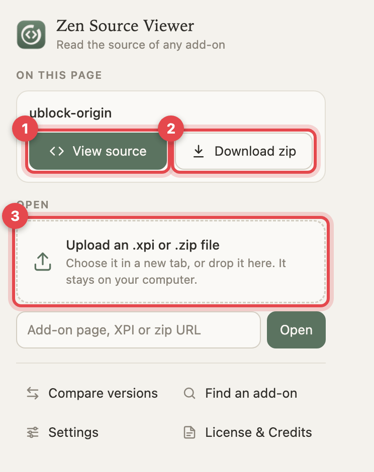

1. **View source** — opens the add-on in the viewer.
2. **Download zip** — saves the add-on as a `.zip` file.
3. **Upload an .xpi, .crx or .zip file** — see below.

**On any other page**, the popup lets you open something else:

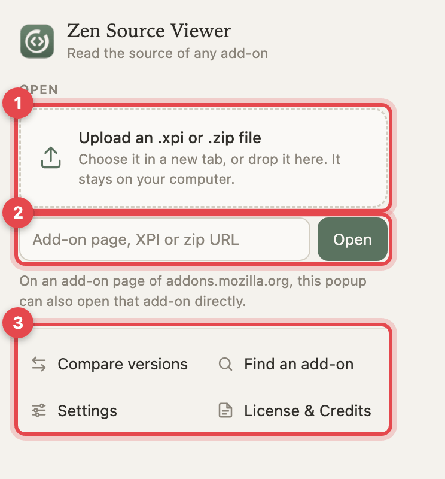

1. **Upload an .xpi, .crx or .zip file** — click it to choose a file in a new tab, or
   drag a file from your computer onto the popup. (Firefox closes popups when a
   file dialog opens, so the file is chosen in a tab.)
2. **Paste a URL** of an add-on page, `.xpi`, `.crx` or `.zip` and click **Open**. You
   can also drop a link onto the popup.
3. **Compare versions**, **Find an add-on**, **Settings**, **License & Credits**.

Right-click the toolbar button to choose what a click does on add-on pages
(show the popup, view the source directly, or download the zip).

### From the Open page

Click **Open** in the viewer (or **Find an add-on** in the popup):

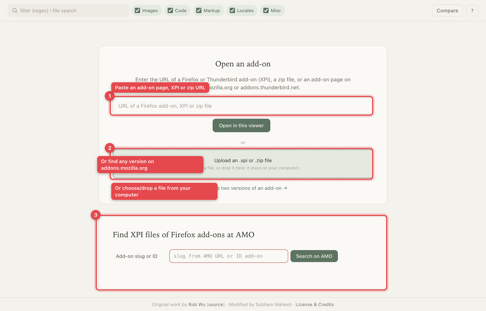

1. Paste the URL of an add-on page, `.xpi`, `.crx` or `.zip`, and click **Open source**.
2. Or choose a file from your computer, or drop it anywhere on the page. To
   work on a folder (your own add-on's source), click **Open a folder** or
   drop the folder (see [Working on a folder](#working-on-a-folder-of-your-computer)).
3. Or find an add-on on addons.mozilla.org by its slug or ID, and pick any of
   its versions.
4. Or get a **Chrome, Edge or Opera extension**: choose the store (only stores
   you turned on are listed), enter the extension ID (the 32 letters at the end
   of a Chrome Web Store or Edge Add-ons page address) or the Opera name, and
   click **Open extension**. For the Chrome Web Store you can also choose the
   **Platform**: operating system, architecture and Chrome version, for
   extensions with different files per platform. Pasting a store page or
   download link in the URL field fills in this form.
   **Your own Chrome-style sites** (see below) are listed too: choose one and
   enter the **Address on this site** of a `.crx` file or a Chrome update file
   (`.xml`). The extension ID is then optional; if you enter it, it is sent
   (with the Chrome version) to pick that extension from the update file.
   The address must be on the site you chose.

### From a link

Right-click a link to an `.xpi` or `.crx` file or an add-on page and choose **View linked
extension source**.

### Chrome, Edge and Opera extensions (CRX)

Extensions for Chromium-based browsers are `.crx` files: a zip file with a
signed header. Zen Source Viewer removes the header and shows the files like any
other add-on. For a CRX file, **Show analysis** on `manifest.json` also shows:

- **Extension ID**: the ID that Chrome, Edge or Opera gives the extension,
  calculated from its public key.
- **Package**: the CRX format (CRX2 or CRX3).
- **Public key**: add it as `"key"` to `manifest.json` to keep the same
  extension ID when you load the extension unpacked.

The **Review** report knows the permissions that only Chrome, Edge and Opera
have (such as `offscreen`, `sidePanel` and `tabCapture`), shows the CRX
extension ID, and warns when `update_url` points to the developer's own server
instead of a store (later versions are then not reviewed by a store).

The **CRX** button next to **Download** saves the original `.crx` file;
**Download** saves the zip file without the header.

**Your own Chrome-style sites.** In **Settings > Add-on sites and right-click menu**, add a domain
and choose **Works like a Chrome store (CRX files)**, for a mirror, a
company store or a developer's update server. Like every site it can be turned
off, and is then never contacted. While it is on, its `.crx` links and its
**Chrome update files** (`.xml`, the `update_url` of an extension) are
recognized by the popup and the right-click menu. Opening an update file opens
the `.crx` file it names (for the extension ID in `?x=id%3D…`, or the first
one); **Show analysis** on `manifest.json` then shows the version and where it
was downloaded from. When an extension updates from its developer's own server,
the review report links to **Open the version it offers now**. To open extensions from
the Chrome Web Store, Microsoft Edge Add-ons or Opera add-ons, turn the store on
in **Settings > Add-on sites and right-click menu** first.

**Secure downloads.** Add-ons are always downloaded over `https`. If a store
or update file points to an `http://` address, or redirects there, the viewer
uses the `https` address instead (and, for Microsoft Edge Add-ons, the
download server whose certificate is valid), so nobody on the network can
swap the file you are about to review.

---

## 2. The viewer

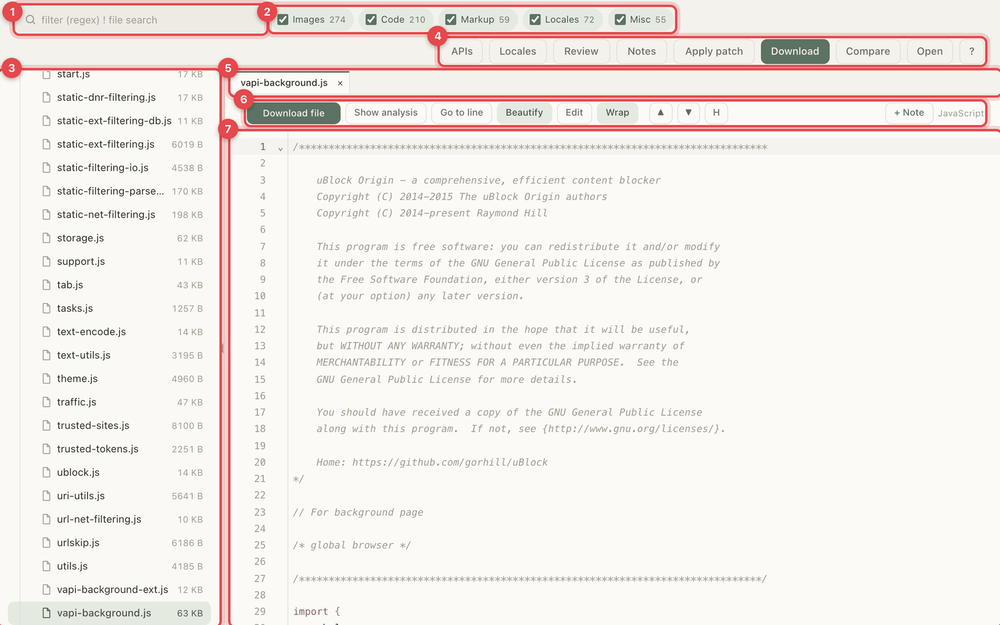

1. **Filter** — type part of a file name (a regular expression) to filter the
   files. Type `!` and text to search inside the files (see [Searching](#4-searching)).
2. **File types** — show or hide images, code, markup, locales and other files.
   The numbers are the file counts.
3. **Folder tree** — click a folder to open or close it, click a file to view it.
   Edited files are marked **M** (modified), **A** (added) or **D** (removed).
4. **Tools** — **APIs**, **Locales**, **Review**, **Notes**, **Apply patch**,
   **Download** (the whole add-on), **Compare**, **Open**, and **?** (keyboard
   shortcuts).
5. **Tabs** — the files you opened recently.
6. **File toolbar** — actions for the shown file (next section).
7. **Code** — the file, with syntax highlighting, line numbers and code folding.

Drag the border between the tree and the code to resize the tree; click the
small arrow on it to hide the tree.

---

## 3. Reading code

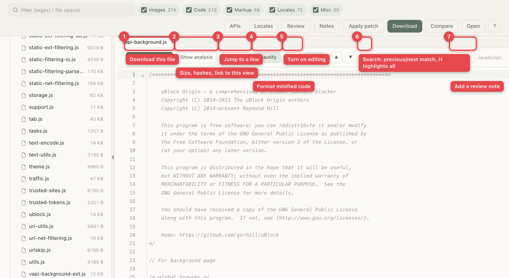

1. **Download file** — saves this file (with your edits, if any).
2. **Show analysis** — size, hashes and a link to this view (see [section 5](#5-file-analysis-and-links)).
3. **Go to line** — jump to a line number.
4. **Beautify** — formats minified code so it is readable. Click again for the
   original code.
5. **Edit** — turns on editing (see [section 6](#6-editing-and-the-changes-panel)).
   **Wrap** wraps long lines.
6. **Search** — ▲ / ▼ go to the previous / next match of your search;
   **H** highlights all matches. Your highlight setting stays active when you switch files.
7. **+ Note** — adds a review note to the line of the cursor (see [section 13](#13-review-notes)).

Images are shown as images; other files that are not text can be downloaded.

---

## 4. Searching

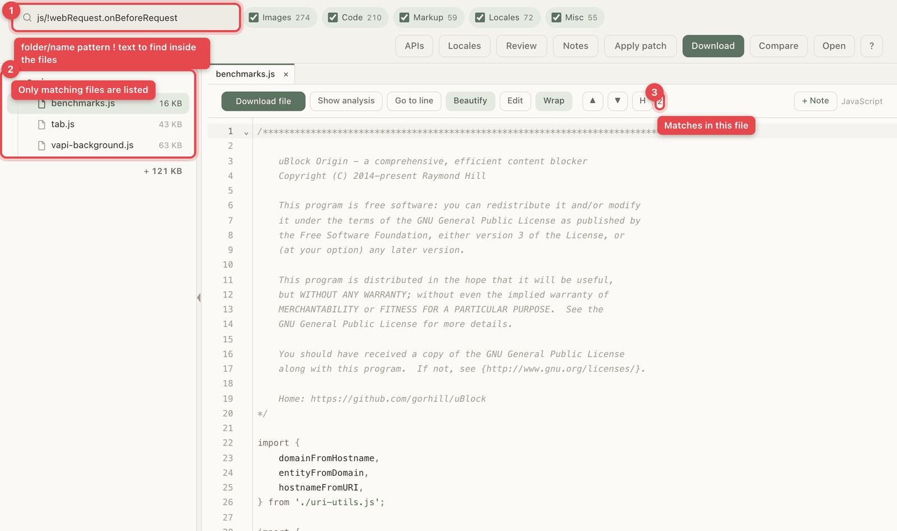

1. Type a search in the filter box. The part before `!` filters file names, the
   part after `!` searches inside the files. Examples:
   - `messaging` — files whose name contains "messaging"
   - `!webRequest` — files that contain "webRequest"
   - `js/!webRequest.onBeforeRequest` — files in `js/` that contain
     `webRequest.onBeforeRequest`
   - `!api:tabs.query` — files that use the `tabs.query` WebExtension API
     (`browser.tabs.query` or `chrome.tabs.query`)
2. Only matching files are listed.
3. In the shown file, the matches are highlighted and counted; use ▲ / ▼ to
   move between them.

To search only in the shown file, press **Ctrl+F** (**⌘F** on a Mac). This
opens the editor's search box, with options for case, regular expressions,
whole words and replace.

---

## 5. File analysis and links

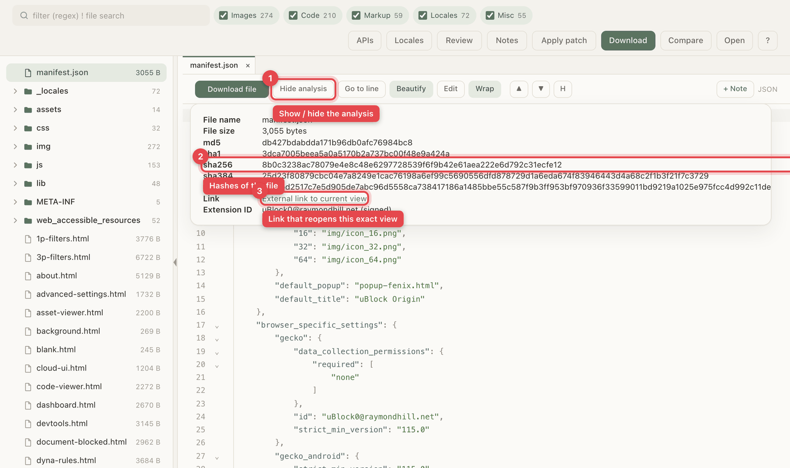

1. **Show analysis** (or **Hide analysis**) on the file toolbar.
2. The size and the **md5, sha1, sha256, sha384 and sha512** hashes of the file.
   For `manifest.json`, the add-on ID is shown too.
3. **External link to current view** — a link that reopens this add-on, this
   file and your filter and search (selected result, highlighting, Beautify)
   in a new tab. Copy it to share or bookmark the view.
   (Not available for files you uploaded, because they have no web address.)

---

## 6. Editing and the Changes panel

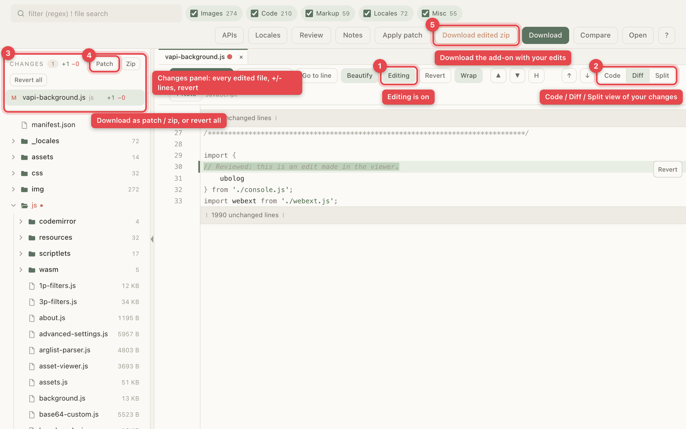

1. Click **Edit** to edit the code. It changes to **Editing** while editing is on.
2. **Code / Diff / Split** — see your changes inline (**Diff**) or side by side
   with the original (**Split**). Use ↑ ↓ to go from change to change, and
   **Revert** on a change to undo it.
3. The **Changes** panel lists every edited file with the lines added and
   removed. Click a file to see its changes; click the ↺ button to discard its
   changes.
4. **Patch** downloads all changes as a patch, **Zip** downloads the add-on with
   your changes, **Revert all** discards all changes.
5. **Download edited zip** (at the top) also downloads the add-on with your changes.

Edits are kept until you close the tab (Firefox asks before closing a tab with
edits).

---

## 7. Files and folders

You can create, rename and delete files and folders of the opened add-on, like
in a file explorer.

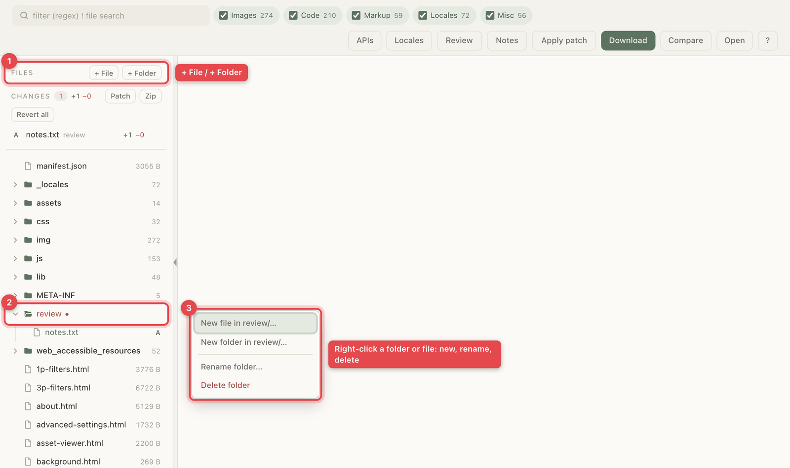

1. **+ File** and **+ Folder** above the tree create a file or folder (in the
   folder of the selected file). A new file opens ready to type.
2. Right-click a **folder** for **New file in …**, **New folder in …**,
   **Rename folder…** (moves everything in it) and **Delete folder**.
3. Right-click a **file** for **Rename…** and **Delete** (and **New file** /
   **New folder** next to it). Right-click empty space in the tree to create
   something at the top level.

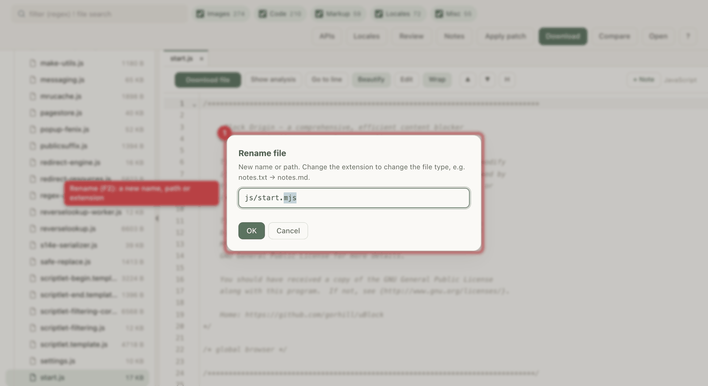

1. **Rename** (or select a file and press **F2**): type a new name, a new folder
   (`js/lib/start.js`), or a new extension to change the file type — for
   example `notes.txt` → `notes.md` or `start.js` → `start.mjs`. Only the name is
   selected, so you can type straight away.

These changes work like edits: a new file is marked **A**, a deleted file **D**,
and a renamed file is deleted under its old name and added under the new one.
They appear in the Changes panel (where you can undo them), in **Patch** and in
the **edited zip**. Notes on a renamed file move with it.

Tip: to write your own review notes in a file, create one (for example
`REVIEW.txt`) with **+ File** and download it with **Download file**, or use
[review notes](#13-review-notes).

---

## 8. Patches

Patches use Git's format, so they work with `git apply`, and patches from
`git diff` (including `git diff --binary`) work here.

- **Download your changes:** **Patch** in the Changes panel.
- **Download the differences of two versions:** **Download patch** on the
  Compare page (see [section 9](#9-comparing-two-versions)).
- **Apply a patch:** click **Apply patch** at the top and choose a `.patch` or
  `.diff` file:

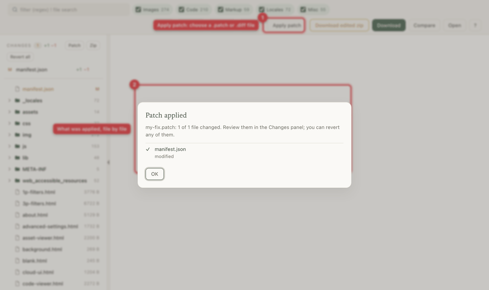

1. **Apply patch** — choose the patch file.
2. A report shows what was applied to each file. The changes appear in the
   Changes panel, where you can review or revert them.

Modified, added, removed and renamed files are supported, also binary files.

### Working on a folder of your computer

Use this for the source of your own add-on, or any folder you want to edit
here and keep the changes on disk.

**Open a folder.** On the Open page, click **Open a folder** and choose it,
or drop the folder onto the drop zone. Its files are packed into a zip in
memory and shown like any add-on; nothing leaves your computer. The `.git`
and `node_modules` folders are left out.

**Save your changes back.** Firefox does not let add-ons write into your
folders, so the changes go back through a patch and one terminal command:

1. Click **Save to folder** at the top (**Apply in terminal** when an
   archive is open; **Terminal** in the Changes panel does the same).
2. The changes are saved as a patch in your Downloads folder
   (`zen-source-viewer-<name>-changes.patch`, directly in Downloads so that
   no folder is left behind), and a dialog shows its full path.
3. Open a terminal in the folder (Finder: right-click it, **New Terminal at
   Folder**; Windows Explorer: right-click, **Open in Terminal**), or type the
   folder's path in **Folder path** to add the `cd` command. The path is
   remembered for the folder.
4. Copy and run the commands: `git apply --check` (tests the patch, changes
   nothing), then `git apply`. `git apply` works in any folder, not only Git
   repositories. On macOS and Linux, `patch -p1 <` works without Git (not for
   binary changes).

**Check that the changes arrived.** After running the command, click
**Reload folder to check** in the dialog, or **Reload folder** at the top.
The folder is read from disk again and compared with your edits:

- **All changes are in …**: every changed file on disk matches your edits.
  The viewer now shows the folder as it is on disk.
- **Some changes are not in …**: lists each file that differs, is missing, or
  should have been deleted. **Put my edits back** applies your edits again to
  the reloaded files, so you can fix the problem and try once more.

A dropped folder is read again directly. A folder chosen with **Open a
folder** has to be chosen once more in the folder picker, because browsers do
not let pages read it again on their own. **Reload folder** also works
without edits, to pick up changes made in another editor.

**Temporary patch file.** With **Temporary** ticked (the default), the patch
file is deleted when you close the dialog, after 10 minutes, or, if you closed
the tab first, the next time the viewer opens. Run the commands before you
close the dialog, or untick **Temporary** to keep the file. **Show in folder**
opens the Downloads folder at the file.

---

## 9. Comparing two versions

Click **Compare** in the viewer (or **Compare versions** in the popup).

### Choose the versions

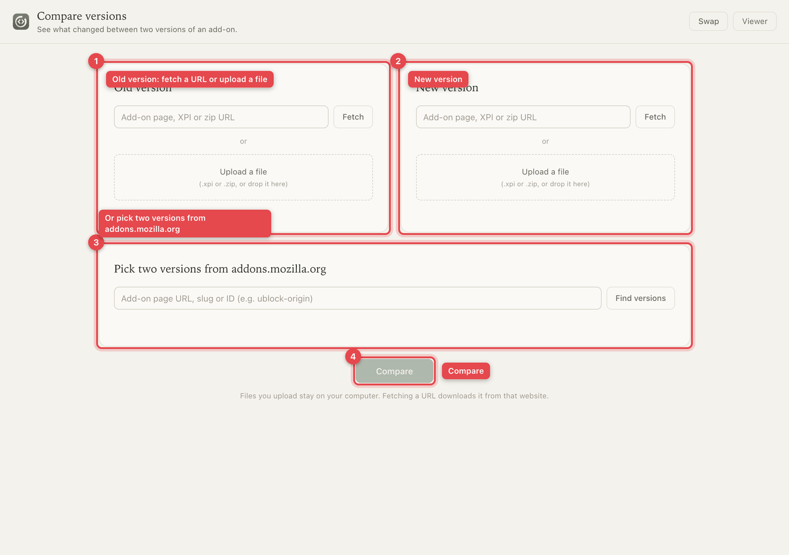

1. **Old version** — paste a URL (add-on page, `.xpi` or `.zip`) and click
   **Fetch**, upload a file, or use a **folder** of your computer: click
   **Choose a folder** or drop the folder onto the drop zone (`.git` and
   `node_modules` are left out).
2. **New version** — the same. Folders and archives can be mixed: for
   example, compare the published `.xpi` with your source folder, or your
   folder before and after your changes.
3. Or find an add-on on addons.mozilla.org and pick two of its versions.
4. Click **Compare**. **Swap** (at the top) swaps the two versions.

### See what changed

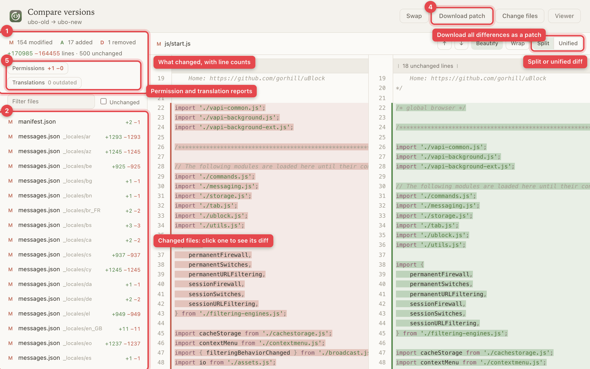

1. The summary: modified (**M**), added (**A**) and removed (**D**) files, and
   the lines added and removed.
2. The changed files. Click one to see its differences; tick **Unchanged** to
   list all files, or type in **Filter files**.
3. **Split** or **Unified** diff. **Beautify** formats minified code first,
   **Wrap** wraps long lines, ↑ ↓ jump between changes.
4. **Download patch** — all differences as one patch.
5. **Permissions** and **Translations** reports (below).

### Permission changes

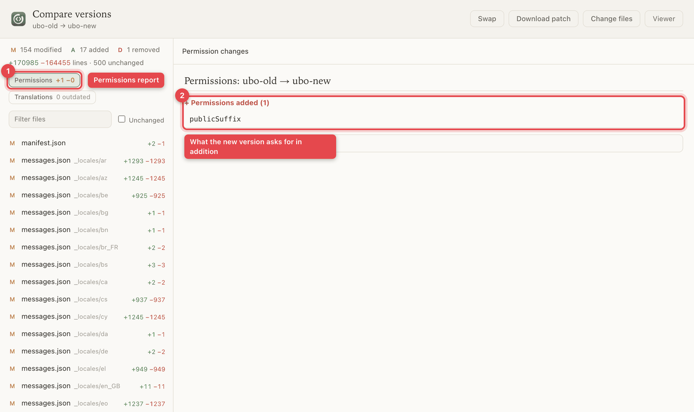

1. Click **Permissions**. Its badge shows how many permissions were added and removed.
2. The permissions, site access and content scripts that the new version adds
   or removes, with how much each matters, and changes to the content security
   policy. **All permissions of …** lists everything the new version asks for.

### Translations that were not updated

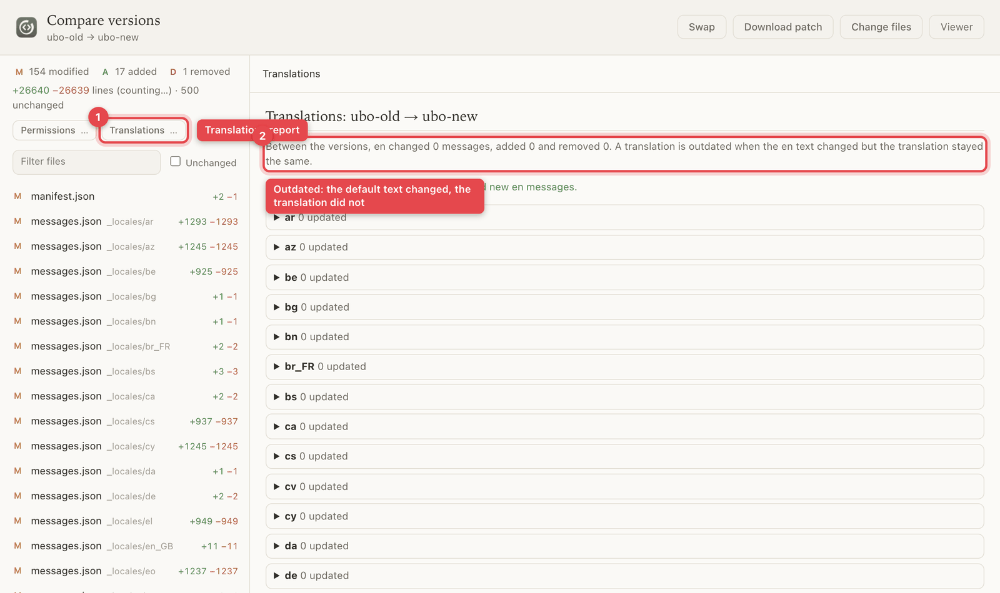

1. Click **Translations**.
2. For each locale: **outdated** messages (the default language's text changed
   between the versions but the translation stayed the same) and **new keys
   missing** (messages added in the new version that the locale does not have).
   Open a locale to see the old text, the new text and the unchanged translation.

---

## 10. Locales and translations

Click **Locales** at the top. The panel lists every locale with how many of the
reference locale's keys it has.

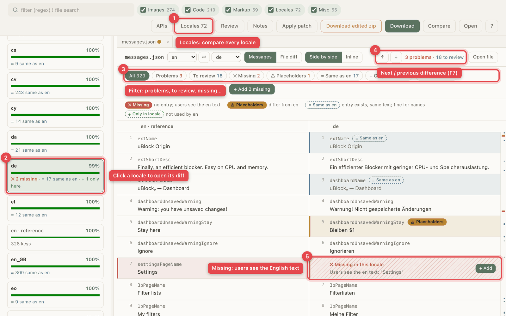

1. **Locales** — scans all `_locales/*/messages.json` files. **Compare locales
   against** chooses the reference (by default the manifest's `default_locale`).
2. Click a locale to compare it with the reference. The counts show its
   **✕ missing** keys, keys that are **= same as** the reference, and keys
   **+ only here**.
3. **Filters**: **All**, **Problems** (missing keys, invalid entries,
   placeholders that differ), **To review** (text the same as the reference,
   keys only in the locale), and each kind on its own. Use the search box to
   filter keys and messages.
4. **↑ ↓** (or **F7** / **Shift+F7**) jump to the next or previous problem or
   key to review. The bar on the right shows where they are; click a mark to
   jump to it.
5. A **missing** key (red): the locale has no entry, so users see the
   reference text instead.

What the marks mean:

| Mark | Meaning |
|---|---|
| **✕ Missing** (red) | The locale has no entry for this key. Firefox shows the reference text. |
| **⚠ Placeholders** (amber) | The `$1` or `$NAME$` placeholders differ from the reference. |
| **= Same as en** (blue, dashed) | The entry exists but its text is the same as the reference. Often fine (names, "Version"), or not translated yet. |
| **+ Only in locale** (green, dashed) | The reference does not have this key; nothing uses it unless the code asks for it. |

Switch **Side by side** / **Inline** to change the layout, **⇄** to swap the two
locales, and **Open file** to open the locale's `messages.json`. Double-click a
row to open the file at that key.

### Editing translations

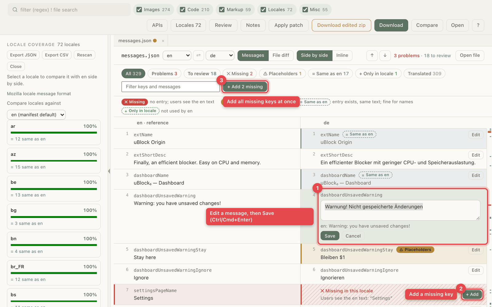

1. Hover a message and click **Edit**, change the text and click **Save**
   (**Ctrl+Enter** / **⌘Enter**). **Esc** cancels.
2. **+ Add** on a missing key adds it, starting from the reference text.
3. **+ Add N missing** adds every missing key at once, with the reference text
   to translate.

Only the changed messages are written, so the file keeps its formatting. The
changes appear in the Changes panel, in patches and in the edited zip.

### Comparing the files line by line

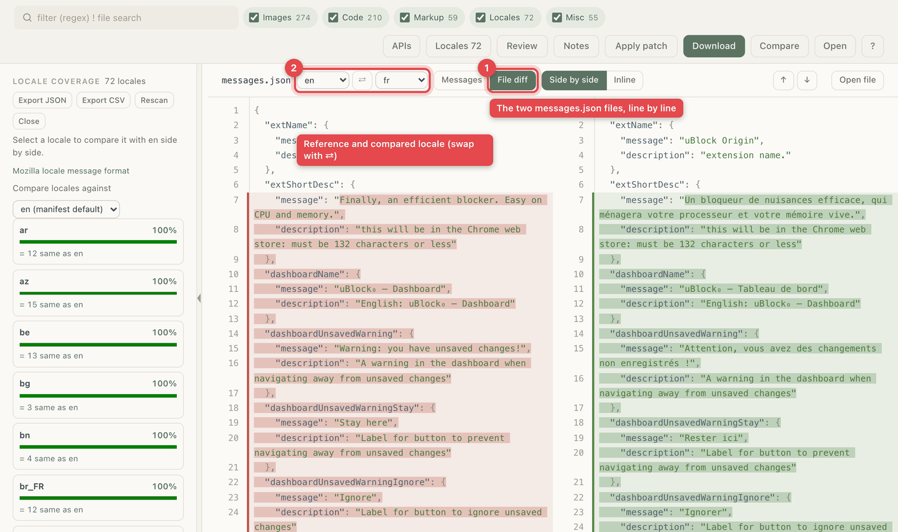

1. **File diff** shows the two `messages.json` files in a line-by-line diff.
2. Choose the reference (left) and the compared locale (right).

**Export JSON** and **Export CSV** in the Locales panel download the comparison
of all locales.

### Fixing placeholders automatically

Placeholders (`$1`, `$COUNT$`) are replaced by values when the message is shown.
A translation that writes them differently shows the wrong text, or none.
When placeholders differ, **Auto-fix N placeholders** suggests fixes:

- `%1`, `%1$s`, `{1}`, `$ 1` and the full-width `＄1` become `$1`;
- a number that lost its `$` (for example `: 1` for `: $1`) gets it back, if
  the reference does not use that number as text;
- a named placeholder with a full-width `＄`, extra spaces or a missing
  closing `$` becomes the reference's `$NAME$` (case does not matter);
- one wrong placeholder where one is missing (`$2` for `$1`) is replaced, and
  marked **check carefully**.

Anything less clear is not guessed: it is listed for manual review.

A dialog lists **Suggested fixes** (selected) and the ones that **Need manual
review** (not selected). Each shows the reference text, the current text and
an editable fix, and says whether its placeholders now match. Untick what you
do not want and choose **Apply selected**; nothing is written before that.

### Translating outside the viewer: export and import

**Export JSON** downloads the keys of the language shown that need work: the
**missing** keys and those with **placeholder** problems, and, if you tick it,
the keys whose text is the **same as the reference**. Each entry has the
reference text, the current text and the description, so a translator (or a
translation tool) can fill in `translation` without the rest of the file.

**Import JSON** reads such a file back. Every change is shown in a review
dialog first, with a placeholder check; keys and languages the add-on does not
have are skipped and listed. Files exported for all languages (see below) can
be imported in one go.

### All languages

**All languages** (next to **File diff**) compares every language with the
reference at once:

1. A table of counts per language and category: **✕ Missing**,
   **⚠ Placeholders**, **✕ Invalid**, **= Same as reference** and
   **+ Only in locale**. Click a count to open that language, filtered to that category.
2. Below it, the keys of one category in every language; **Open** shows a key
   in that language's diff.
3. **Auto-fix placeholders in all languages**, **Export JSON (all languages)**
   and **Import JSON** work on every language together, with the same review
   dialogs.

### Message keys used in the code

**In code** checks the other direction: not whether each language has the
reference's messages, but whether the reference has every message the code
asks for. A key the code uses but `messages.json` lacks makes
`getMessage` return an empty string, in every language.

The JS, HTML, CSS and `manifest.json` files of the add-on are scanned for:

- `browser.i18n.getMessage("key")` (also `chrome.` and `messenger.`), and
  helper functions that pass their argument on to it, such as
  `function t(key) { return browser.i18n.getMessage(key); }` or
  `const _ = chrome.i18n.getMessage.bind(chrome.i18n)`, even when the helper
  is defined in another file;
- `__MSG_key__` in any file;
- `data-i18n`, `data-i18n-title`, `data-l10n-id`, `i18n-content` and similar
  attributes, also in HTML written by scripts.

Keys built at run time become patterns, with `*` for the part that changes:
`'help_line' + i` becomes `help_line*`, `` `tab_${name}_title` `` becomes
`tab_*_title`, and `t(base + '_line1')` after `const base = 'section_' + id`
becomes `section_*_line1`. Both sides of `flag ? 'yes' : 'no'` are checked.

| Category | Meaning |
|---|---|
| **✕ Missing from reference** | Used in the code, but the reference has no such message. Shows which languages have it, if any. |
| **⚠ Generated, no match** | A key built at run time that matches no message. |
| **✕ Invalid name** | Message names may only contain letters, digits, `_` and `@` (for example `bad.key` is invalid). |
| **\* Generated keys** | Every key built at run time, with the messages it matches. |
| **? Not worked out** | The key comes from a value the scan cannot follow, such as `getMessage(someKey)` with `someKey` from elsewhere. |
| **○ Not found in code** | Messages no code is found to use. If some keys could not be worked out, they may still be used. |

Each use links to its file and line. **+ Add N to …** asks for the message of
each missing key and writes the keys you filled in to the reference
`messages.json`. **Rescan code** reads the code again after you edit it.

The scan reads the code; it does not run it. A key passed through several
functions before it reaches `getMessage` may not be followed and then shows as
**Not worked out**. The **Review** report's count of message keys used but not
defined is a quicker check of literal keys only.

---

## 11. APIs

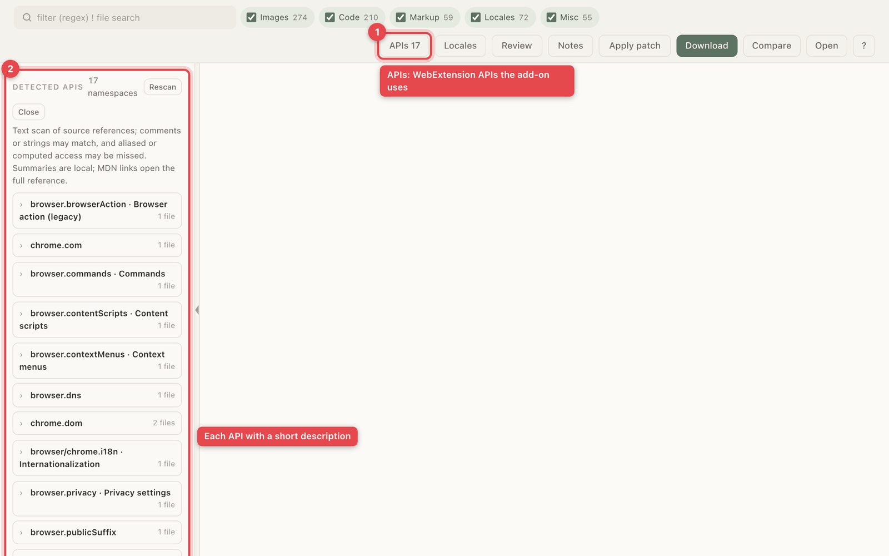

1. Click **APIs** at the top. The add-on's code is scanned for WebExtension APIs
   (`browser.*` and `chrome.*`). The API list fills the sidebar and scrolls independently.
2. Expand an API to see its members and their descriptions. Descriptions come
   with the add-on and link to the full reference on MDN.
3. Click **Show files** next to a member to open a matching file at the API
   reference. The sidebar shows the matching files immediately, with the API
   name and file count above them. Use **← APIs** to return to the API list,
   or **Clear search** to show all files.

To find where an API is used, search for it with `!api:` in the filter box,
for example `!api:tabs.query`.

---

## 12. Review report

Click **Review** at the top for a report about the whole add-on.

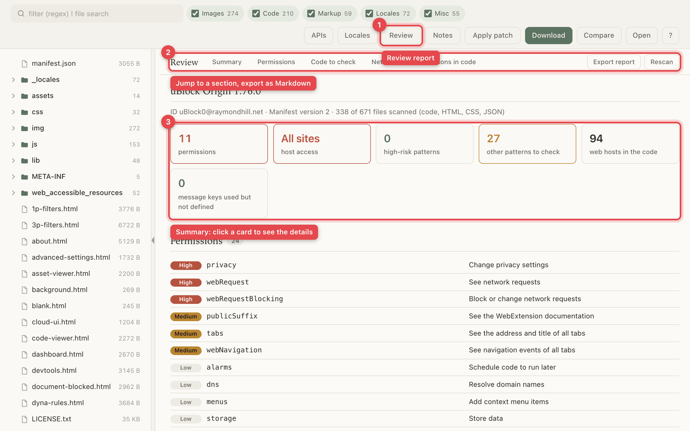

1. **Review** — opens the report (it takes a moment for large add-ons).
2. Jump to a section, **Export report** as Markdown, or **Rescan** after edits.
3. The summary: permissions, site access, risky code patterns, web addresses
   and translation keys. Click a card to see its details.

The sections:

- **Permissions** — each permission with what it allows and how much it matters
  (**High**, **Medium**, **Low**), site access, content scripts, the content
  security policy (with warnings for `unsafe-eval` and remote scripts),
  web-accessible resources.
- **Code to check** — see below.
- **Network** — every web address in the code, grouped by host. Some are only
  links or documentation.
- **Translations in code** — message keys that the code uses
  (`__MSG_name__`, `getMessage("name")`) but no `messages.json` defines (users
  would see an empty text), and keys that are defined but never mentioned in the code.

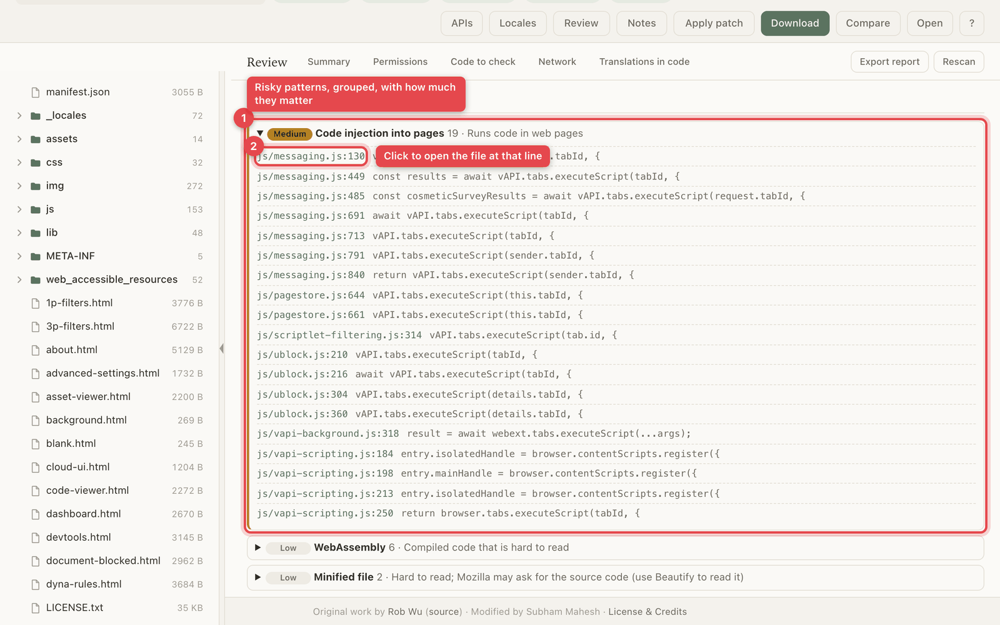

1. Risky patterns, grouped and sorted by how much they matter: `eval()`,
   `new Function()`, timers with strings, HTML from variables (`innerHTML`,
   `document.write`), remote scripts, code injection into pages, WebAssembly,
   minified and obfuscated files. Comments are ignored.
2. Click a place (`file:line`) to open the file at that line.

---

## 13. Review notes

Notes help you keep track of what to check or report. They are kept for this
browser session only: they survive reloading the tab, and are gone when you
close it. Export them to keep them.

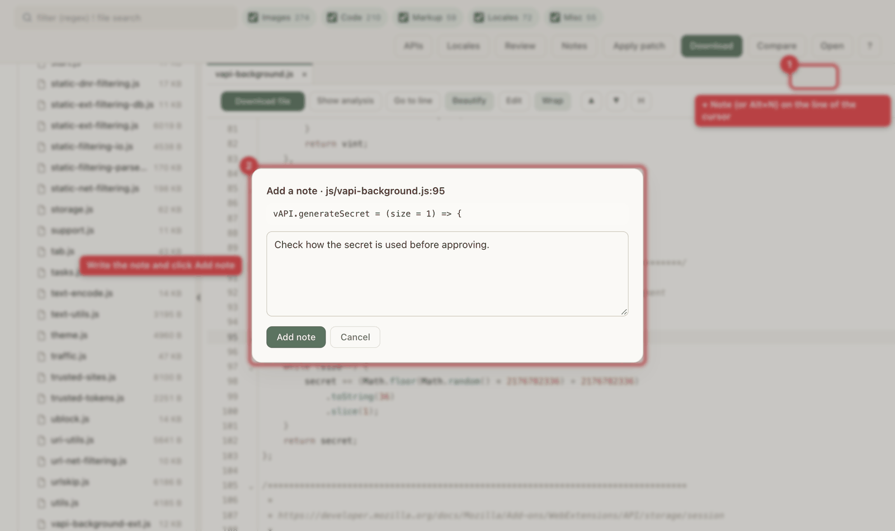

1. Put the cursor on a line and click **+ Note** (or press **Alt+N**).
2. Write the note and click **Add note**. A dot appears next to the line; click
   it to edit or delete the note.

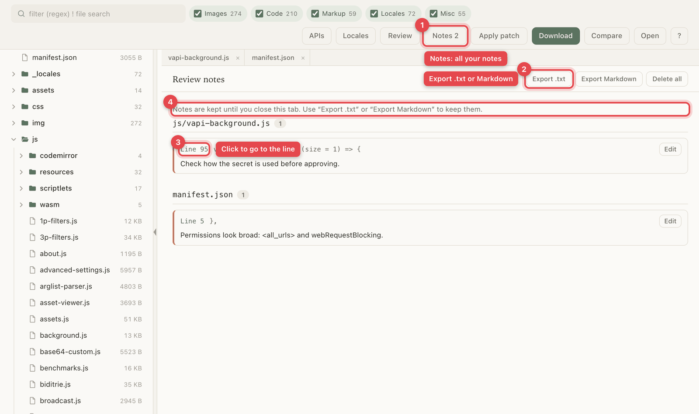

1. **Notes** at the top lists all notes, by file.
2. **Export .txt** downloads a text file with, for each note, the file, the
   line, the code of that line, when it was written and the note (plus the
   add-on file and its SHA-256). **Export Markdown** does the same as Markdown.
   **Delete all** removes them.
3. Click a line link to go to the note's line; **Edit** changes or deletes it.
4. A reminder that notes are kept until you close the tab.

Example of an exported `.txt`:

```
Review notes
============================================================
Add-on file: ublock_origin-1.76.0 (SHA-256 6f20ff67…)
Exported:    11/11/2026, 01:25:20
Notes:       2

============================================================
File: js/vapi-background.js (1 note)
============================================================

[1] Line 95  ·  11/11/2026, 01:24:02
    Code: vAPI.generateSecret = (size = 1) => {
    Check how the secret is used before approving.
```

---

## 14. Quick open, symbols and tabs

### Quick open

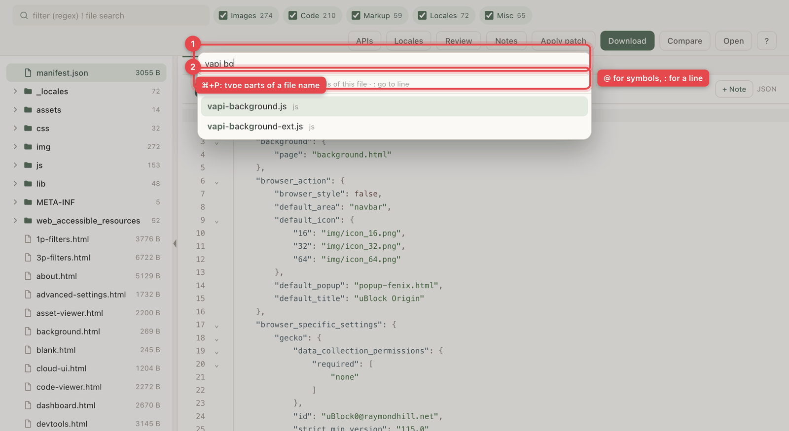

1. Press **Ctrl+P** (**⌘P**) and type parts of a file name, for example
   `vapi bg` for `vapi-background.js`. Use ↑ ↓ and **Enter** to open a file.
2. Start with **@** to go to a symbol of the shown file, or **:** to go to a
   line (for example `:120`).

### Go to symbol

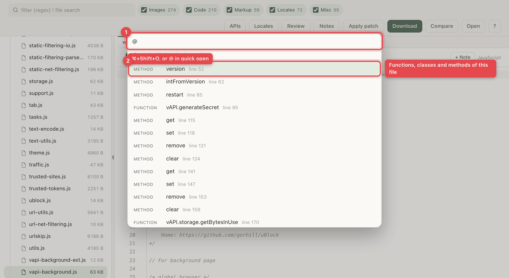

1. Press **Ctrl+Shift+O** (**⌘⇧O**), or type **@** in quick open.
2. The functions, classes and methods of a JavaScript file (or the selectors of
   CSS, the ids of HTML, the keys of JSON, the headings of Markdown). Type to
   filter, **Enter** to jump. For minified code, click **Beautify** first.

If Firefox uses **Ctrl+Shift+O** for its own window, use **@** in quick open.

### Tabs

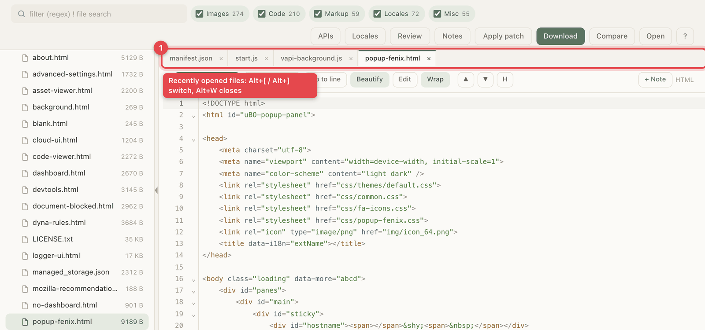

1. Files you open appear as tabs. Click a tab to switch, **×** (or a middle
   click) to close it. **Alt+[** and **Alt+]** switch to the previous / next
   tab, **Alt+W** closes the tab. Edited files show a dot.

---

## 15. Keyboard shortcuts

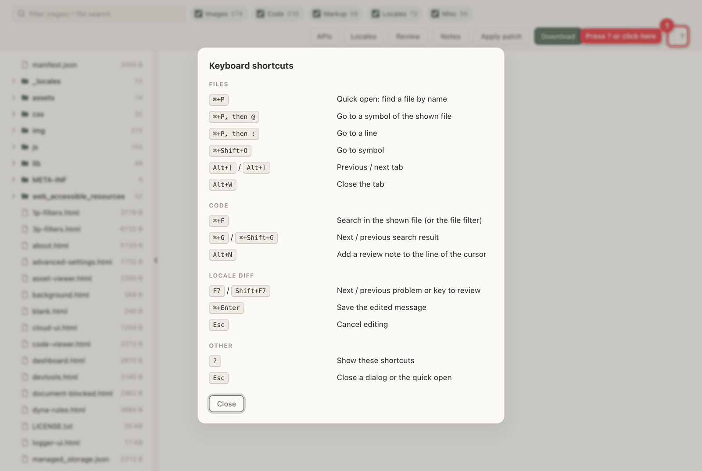

1. Press **?** (when you are not typing) or click **?** at the top to see all
   shortcuts.

| Shortcut | What it does |
|---|---|
| **Ctrl/⌘+P** | Quick open a file |
| **Ctrl/⌘+P**, then **@** / **:** | Go to a symbol / a line |
| **Ctrl/⌘+Shift+O** | Go to symbol |
| **Alt+[** / **Alt+]** | Previous / next tab |
| **Alt+W** | Close the tab |
| **Ctrl/⌘+F** | Search in the shown file (or the file filter) |
| **Ctrl/⌘+G** / **Ctrl/⌘+Shift+G** | Next / previous search result |
| **Alt+N** | Add a review note |
| **F2** | Rename the selected file |
| **F7** / **Shift+F7** | Next / previous difference in the locale diff |
| **Ctrl/⌘+Enter** | Save an edited message |
| **Esc** | Cancel, close a dialog or quick open |
| **?** | Show the shortcuts |

---

## 16. Settings

Choose **System**, **Light**, or **Dark** under **Appearance** in the popup or Settings.
Your choice is shared across the popup, viewer, comparison, and other add-on pages,
and updates open pages immediately. **System** follows your device's theme.

Open **Settings** from the popup (or about:addons → Zen Source Viewer → Options).

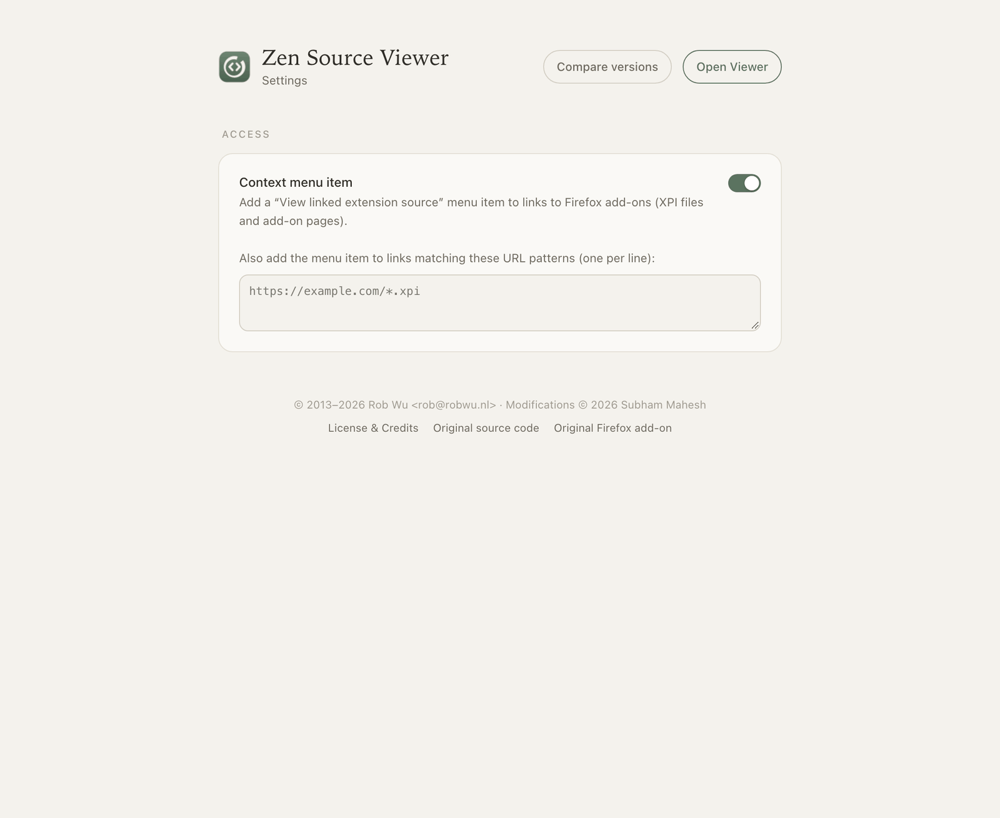

- **Add-on sites and right-click menu** — one section for both:
  - **Right-click menu** (at the top) shows **View linked extension source**
    when you right-click a link to an `.xpi` or `.crx` file, or an add-on page
    of a site that is turned on.
  - The **Mozilla sites** and **Chrome, Edge and Opera stores** can each be
    turned on or off.
  - **Sites and links you added**: add a domain that works like
    addons.mozilla.org, addons.thunderbird.net or a Chrome store, or choose
    **Right-click menu only (link pattern)** and enter a pattern such as
    `https://example.com/*.crx` to show the menu item on other links too.
    Every entry has its own **Remove** button.
- **Privacy** — shows which version of the privacy policy you agreed to.
  **Withdraw consent** turns the add-on off until you agree again.

---

## 17. Privacy

Zen Source Viewer does not collect any data. It connects to a website only when
you ask it to fetch an add-on or file. Files and folders you open never leave
your computer. Review notes are kept only until you close the tab, and a few
display choices are saved in your browser, as are the folder paths you type in
the terminal dialog. Temporary patch files are deleted again (see
[Working on a folder](#working-on-a-folder-of-your-computer)).
See the [privacy policy](../PRIVACY.md) for details.

**Consent.** Before you can use the add-on, it shows the privacy policy and the
[End User License Agreement](../EULA.md) (switch between them above the text)
and asks you to agree. The agreement covers the packaged add-on only: use it for
any lawful purpose, not for anything unlawful. It does not limit your rights in
the source code under the MPL 2.0 and the FLPL. Until you agree, every page of the add-on (popup, viewer, Compare,
Settings) shows this consent page instead. If the policy changes, you are asked
again. The policy is also available from **Privacy Policy** in the popup, the
viewer and Settings.
