# Zen Source Viewer — User Guide

Zen Source Viewer shows the source code of Firefox and Thunderbird add-ons
without installing them. You can read, search and edit the code, compare two
versions, check translations, review permissions and risky code, and keep
review notes. Everything runs in your browser; files you open stay on your
computer.

The red numbers in the screenshots show what to click. The screenshots use
uBlock Origin as an example.

## Contents

1. [Opening an add-on](#1-opening-an-add-on)
2. [The viewer](#2-the-viewer)
3. [Reading code](#3-reading-code)
4. [Searching](#4-searching)
5. [File analysis and links](#5-file-analysis-and-links)
6. [Editing and the Changes panel](#6-editing-and-the-changes-panel)
7. [Files and folders](#7-files-and-folders)
8. [Patches](#8-patches)
9. [Comparing two versions](#9-comparing-two-versions)
10. [Locales and translations](#10-locales-and-translations)
11. [APIs](#11-apis)
12. [Review report](#12-review-report)
13. [Review notes](#13-review-notes)
14. [Quick open, symbols and tabs](#14-quick-open-symbols-and-tabs)
15. [Keyboard shortcuts](#15-keyboard-shortcuts)
16. [Settings](#16-settings)
17. [Privacy](#17-privacy)

---

## 1. Opening an add-on

### From the toolbar button

Click the **Zen Source Viewer** button in the Firefox toolbar. (If you do not
see it, right-click the toolbar, choose **Customize Toolbar…** and drag it
there.)

**On an add-on page** of addons.mozilla.org or addons.thunderbird.net (or on a
link to an `.xpi` file), the popup offers that add-on:

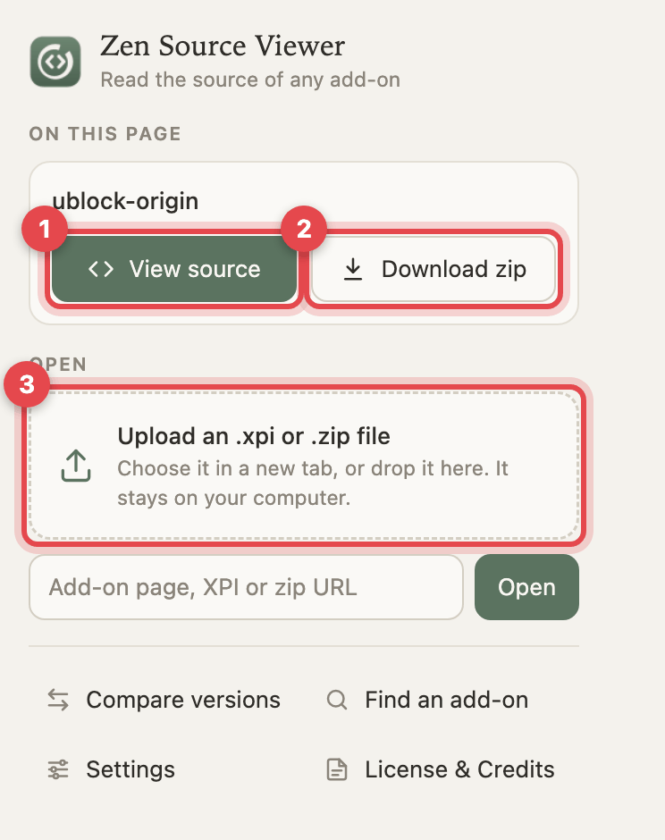

1. **View source** — opens the add-on in the viewer.
2. **Download zip** — saves the add-on as a `.zip` file.
3. **Upload an .xpi or .zip file** — see below.

**On any other page**, the popup lets you open something else:

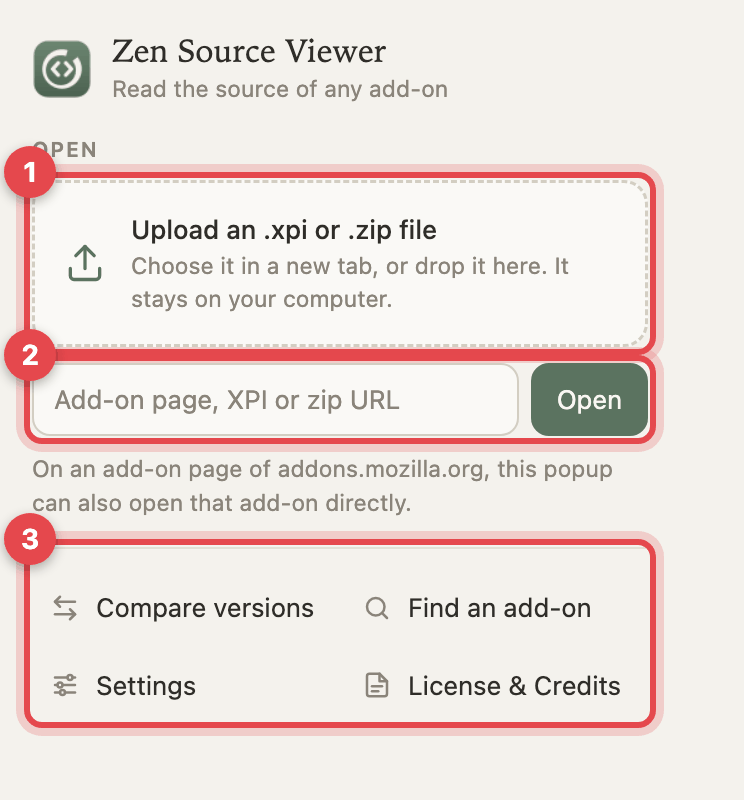

1. **Upload an .xpi or .zip file** — click it to choose a file in a new tab, or
   drag a file from your computer onto the popup. (Firefox closes popups when a
   file dialog opens, so the file is chosen in a tab.)
2. **Paste a URL** of an add-on page, `.xpi` or `.zip` and click **Open**. You
   can also drop a link onto the popup.
3. **Compare versions**, **Find an add-on**, **Settings**, **License & Credits**.

Right-click the toolbar button to choose what a click does on add-on pages
(show the popup, view the source directly, or download the zip).

### From the Open page

Click **Open** in the viewer (or **Find an add-on** in the popup):

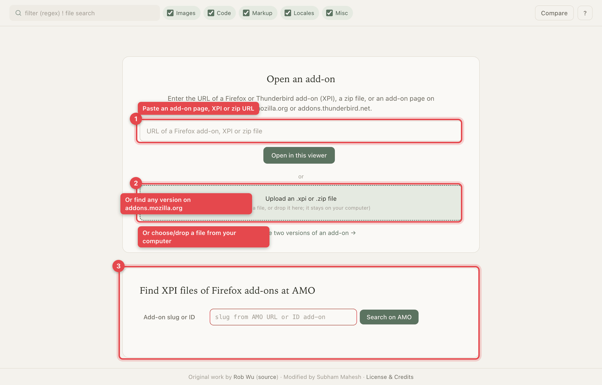

1. Paste the URL of an add-on page, `.xpi` or `.zip`, and click **Open in this viewer**.
2. Or choose a file from your computer, or drop it anywhere on the page.
3. Or find an add-on on addons.mozilla.org by its slug or ID, and pick any of
   its versions.

### From a link

Right-click a link to an `.xpi` file or an add-on page and choose **View linked
extension source**.

---

## 2. The viewer

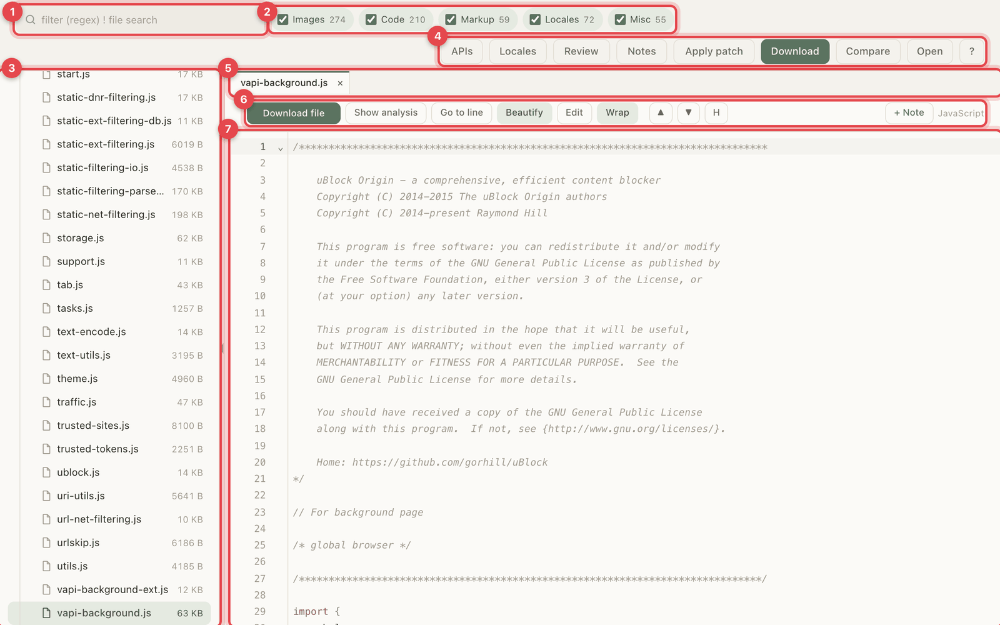

1. **Filter** — type part of a file name (a regular expression) to filter the
   files. Type `!` and text to search inside the files (see [Searching](#4-searching)).
2. **File types** — show or hide images, code, markup, locales and other files.
   The numbers are the file counts.
3. **Folder tree** — click a folder to open or close it, click a file to view it.
   Edited files are marked **M** (modified), **A** (added) or **D** (removed).
4. **Tools** — **APIs**, **Locales**, **Review**, **Notes**, **Apply patch**,
   **Download** (the whole add-on), **Compare**, **Open**, and **?** (keyboard
   shortcuts).
5. **Tabs** — the files you opened recently.
6. **File toolbar** — actions for the shown file (next section).
7. **Code** — the file, with syntax highlighting, line numbers and code folding.

Drag the border between the tree and the code to resize the tree; click the
small arrow on it to hide the tree.

---

## 3. Reading code

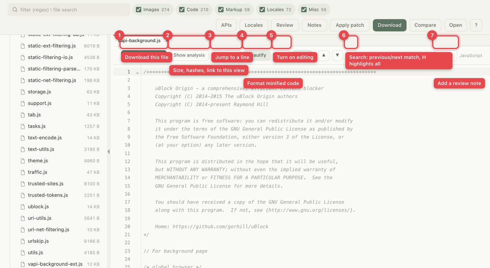

1. **Download file** — saves this file (with your edits, if any).
2. **Show analysis** — size, hashes and a link to this view (see [section 5](#5-file-analysis-and-links)).
3. **Go to line** — jump to a line number.
4. **Beautify** — formats minified code so it is readable. Click again for the
   original code.
5. **Edit** — turns on editing (see [section 6](#6-editing-and-the-changes-panel)).
   **Wrap** wraps long lines.
6. **Search** — ▲ / ▼ go to the previous / next match of your search;
   **H** highlights all matches.
7. **+ Note** — adds a review note to the line of the cursor (see [section 13](#13-review-notes)).

Images are shown as images; other files that are not text can be downloaded.

---

## 4. Searching

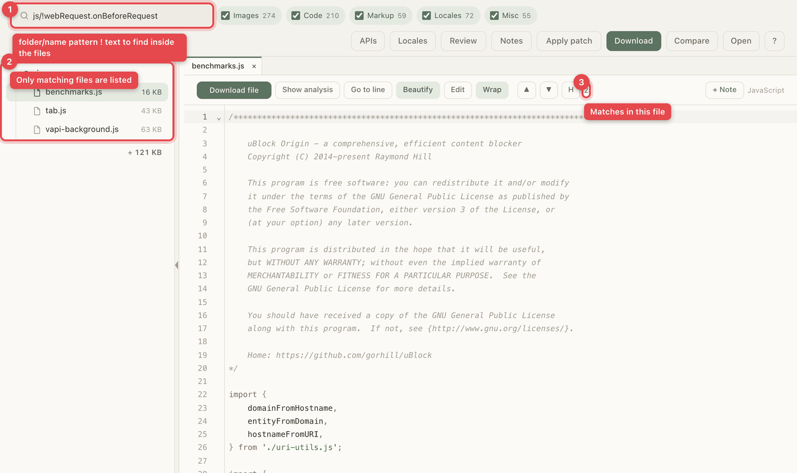

1. Type a search in the filter box. The part before `!` filters file names, the
   part after `!` searches inside the files. Examples:
   - `messaging` — files whose name contains "messaging"
   - `!webRequest` — files that contain "webRequest"
   - `js/!webRequest.onBeforeRequest` — files in `js/` that contain
     `webRequest.onBeforeRequest`
   - `!api:tabs.query` — files that use the `tabs.query` WebExtension API
     (`browser.tabs.query` or `chrome.tabs.query`)
2. Only matching files are listed.
3. In the shown file, the matches are highlighted and counted; use ▲ / ▼ to
   move between them.

To search only in the shown file, press **Ctrl+F** (**⌘F** on a Mac). This
opens the editor's search box, with options for case, regular expressions,
whole words and replace.

---

## 5. File analysis and links

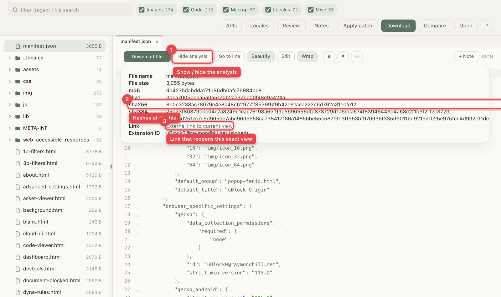

1. **Show analysis** (or **Hide analysis**) on the file toolbar.
2. The size and the **md5, sha1, sha256, sha384 and sha512** hashes of the file.
   For `manifest.json`, the add-on ID is shown too.
3. **External link to current view** — a link that reopens this add-on, this
   file and your filter and search (selected result, highlighting, Beautify)
   in a new tab. Copy it to share or bookmark the view.
   (Not available for files you uploaded, because they have no web address.)

---

## 6. Editing and the Changes panel

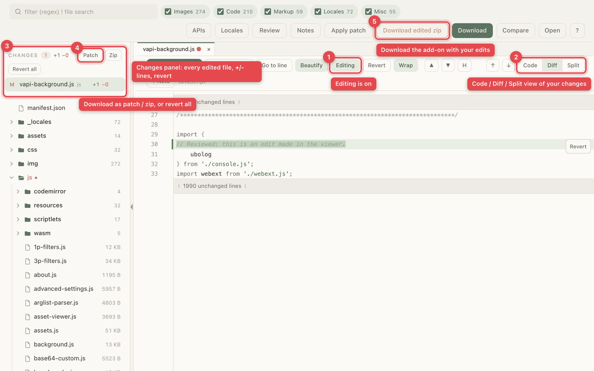

1. Click **Edit** to edit the code. It changes to **Editing** while editing is on.
2. **Code / Diff / Split** — see your changes inline (**Diff**) or side by side
   with the original (**Split**). Use ↑ ↓ to go from change to change, and
   **Revert** on a change to undo it.
3. The **Changes** panel lists every edited file with the lines added and
   removed. Click a file to see its changes; click the ↺ button to discard its
   changes.
4. **Patch** downloads all changes as a patch, **Zip** downloads the add-on with
   your changes, **Revert all** discards all changes.
5. **Download edited zip** (at the top) also downloads the add-on with your changes.

Edits are kept until you close the tab (Firefox asks before closing a tab with
edits).

---

## 7. Files and folders

You can create, rename and delete files and folders of the opened add-on, like
in a file explorer.

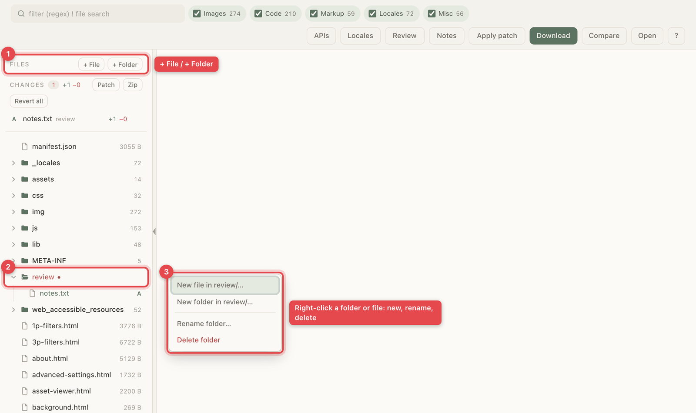

1. **+ File** and **+ Folder** above the tree create a file or folder (in the
   folder of the selected file). A new file opens ready to type.
2. Right-click a **folder** for **New file in …**, **New folder in …**,
   **Rename folder…** (moves everything in it) and **Delete folder**.
3. Right-click a **file** for **Rename…** and **Delete** (and **New file** /
   **New folder** next to it). Right-click empty space in the tree to create
   something at the top level.

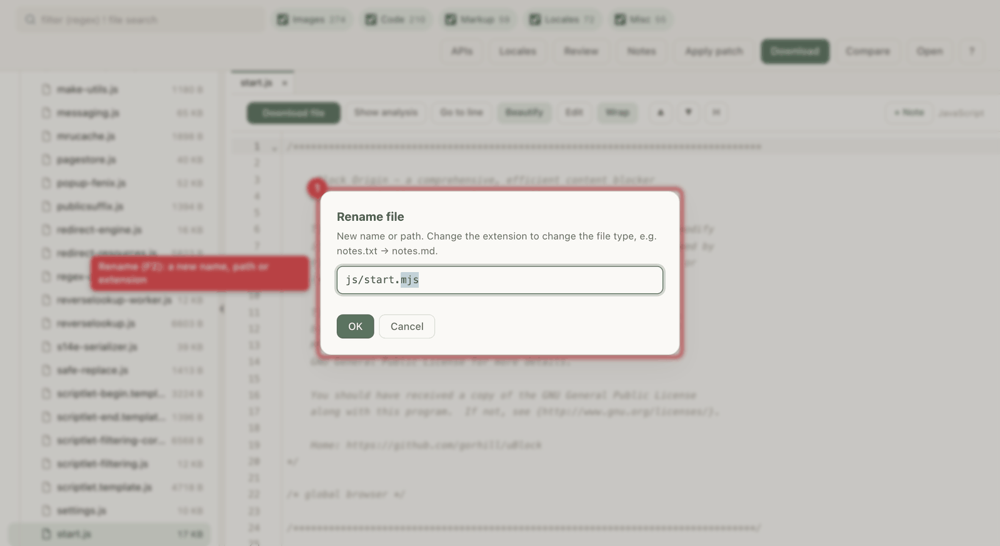

1. **Rename** (or select a file and press **F2**): type a new name, a new folder
   (`js/lib/start.js`), or a new extension to change the file type — for
   example `notes.txt` → `notes.md` or `start.js` → `start.mjs`. Only the name is
   selected, so you can type straight away.

These changes work like edits: a new file is marked **A**, a deleted file **D**,
and a renamed file is deleted under its old name and added under the new one.
They appear in the Changes panel (where you can undo them), in **Patch** and in
the **edited zip**. Notes on a renamed file move with it.

Tip: to write your own review notes in a file, create one (for example
`REVIEW.txt`) with **+ File** and download it with **Download file**, or use
[review notes](#13-review-notes).

---

## 8. Patches

Patches use Git's format, so they work with `git apply`, and patches from
`git diff` (including `git diff --binary`) work here.

- **Download your changes:** **Patch** in the Changes panel.
- **Download the differences of two versions:** **Download patch** on the
  Compare page (see [section 9](#9-comparing-two-versions)).
- **Apply a patch:** click **Apply patch** at the top and choose a `.patch` or
  `.diff` file:

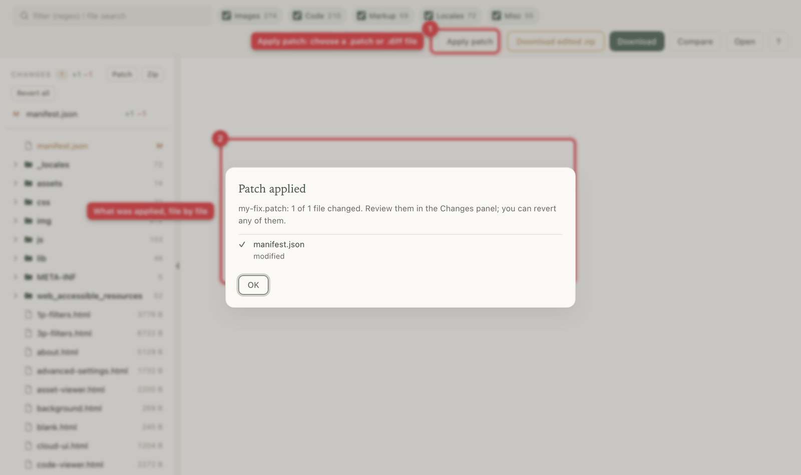

1. **Apply patch** — choose the patch file.
2. A report shows what was applied to each file. The changes appear in the
   Changes panel, where you can review or revert them.

Modified, added, removed and renamed files are supported, also binary files.

---

## 9. Comparing two versions

Click **Compare** in the viewer (or **Compare versions** in the popup).

### Choose the versions

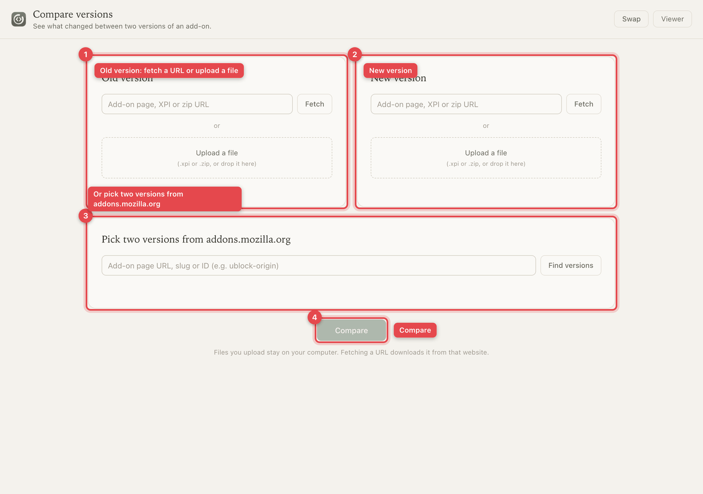

1. **Old version** — paste a URL (add-on page, `.xpi` or `.zip`) and click
   **Fetch**, or upload a file.
2. **New version** — the same.
3. Or find an add-on on addons.mozilla.org and pick two of its versions.
4. Click **Compare**. **Swap** (at the top) swaps the two versions.

### See what changed

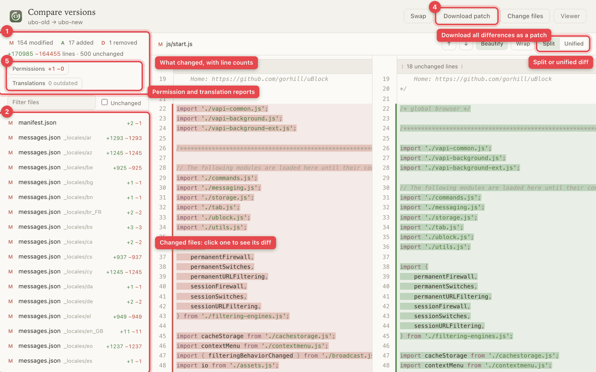

1. The summary: modified (**M**), added (**A**) and removed (**D**) files, and
   the lines added and removed.
2. The changed files. Click one to see its differences; tick **Unchanged** to
   list all files, or type in **Filter files**.
3. **Split** or **Unified** diff. **Beautify** formats minified code first,
   **Wrap** wraps long lines, ↑ ↓ jump between changes.
4. **Download patch** — all differences as one patch.
5. **Permissions** and **Translations** reports (below).

### Permission changes

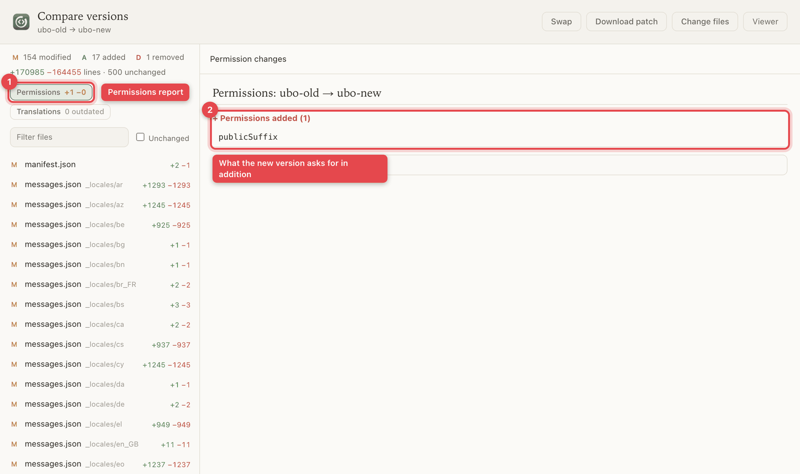

1. Click **Permissions**. Its badge shows how many permissions were added and removed.
2. The permissions, site access and content scripts that the new version adds
   or removes, with how much each matters, and changes to the content security
   policy. **All permissions of …** lists everything the new version asks for.

### Translations that were not updated

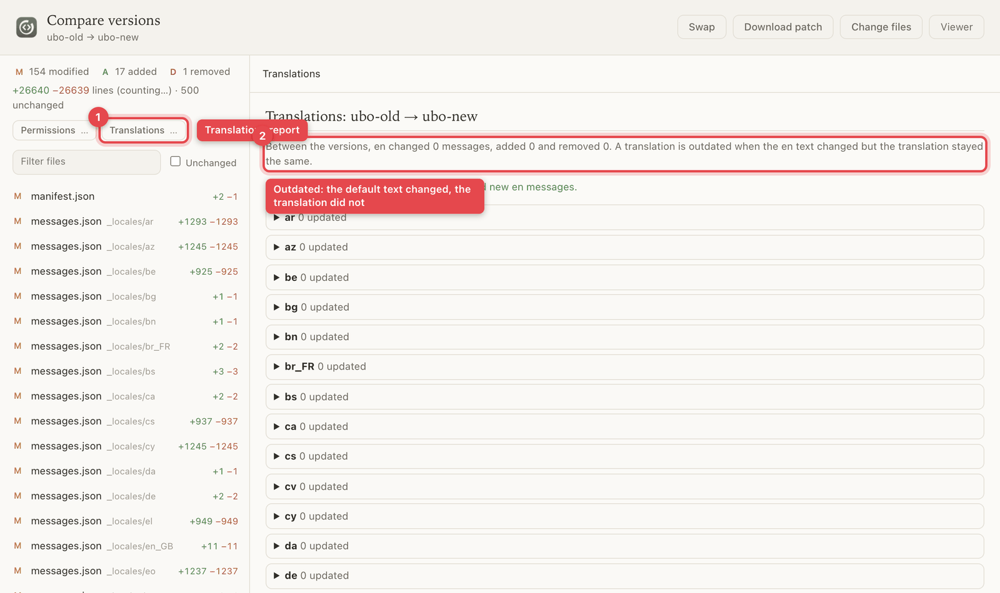

1. Click **Translations**.
2. For each locale: **outdated** messages (the default language's text changed
   between the versions but the translation stayed the same) and **new keys
   missing** (messages added in the new version that the locale does not have).
   Open a locale to see the old text, the new text and the unchanged translation.

---

## 10. Locales and translations

Click **Locales** at the top. The panel lists every locale with how many of the
reference locale's keys it has.

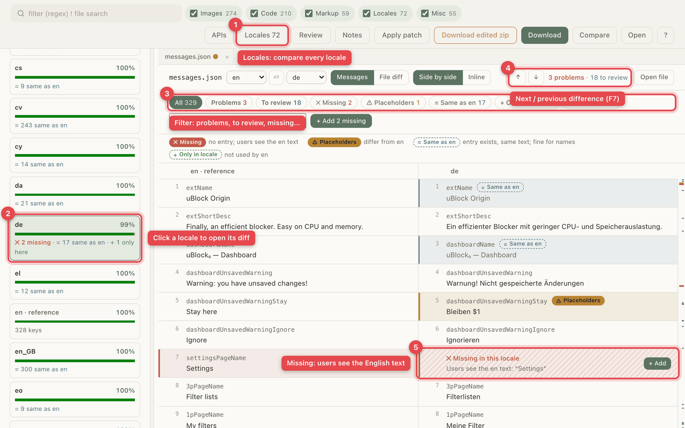

1. **Locales** — scans all `_locales/*/messages.json` files. **Compare locales
   against** chooses the reference (by default the manifest's `default_locale`).
2. Click a locale to compare it with the reference. The counts show its
   **✕ missing** keys, keys that are **= same as** the reference, and keys
   **+ only here**.
3. **Filters**: **All**, **Problems** (missing keys, invalid entries,
   placeholders that differ), **To review** (text the same as the reference,
   keys only in the locale), and each kind on its own. Use the search box to
   filter keys and messages.
4. **↑ ↓** (or **F7** / **Shift+F7**) jump to the next or previous problem or
   key to review. The bar on the right shows where they are; click a mark to
   jump to it.
5. A **missing** key (red): the locale has no entry, so users see the
   reference text instead.

What the marks mean:

| Mark | Meaning |
|---|---|
| **✕ Missing** (red) | The locale has no entry for this key. Firefox shows the reference text. |
| **⚠ Placeholders** (amber) | The `$1` or `$NAME$` placeholders differ from the reference. |
| **= Same as en** (blue, dashed) | The entry exists but its text is the same as the reference. Often fine (names, "Version"), or not translated yet. |
| **+ Only in locale** (green, dashed) | The reference does not have this key; nothing uses it unless the code asks for it. |

Switch **Side by side** / **Inline** to change the layout, **⇄** to swap the two
locales, and **Open file** to open the locale's `messages.json`. Double-click a
row to open the file at that key.

### Editing translations

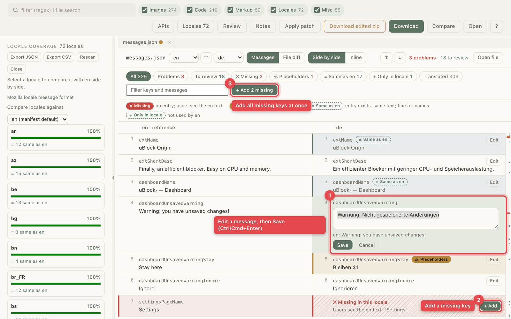

1. Hover a message and click **Edit**, change the text and click **Save**
   (**Ctrl+Enter** / **⌘Enter**). **Esc** cancels.
2. **+ Add** on a missing key adds it, starting from the reference text.
3. **+ Add N missing** adds every missing key at once, with the reference text
   to translate.

Only the changed messages are written, so the file keeps its formatting. The
changes appear in the Changes panel, in patches and in the edited zip.

### Comparing the files line by line

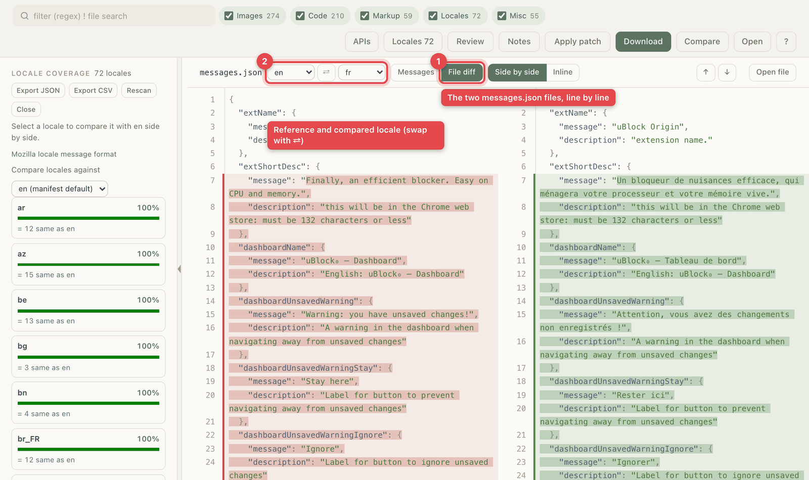

1. **File diff** shows the two `messages.json` files in a line-by-line diff.
2. Choose the reference (left) and the compared locale (right).

**Export JSON** and **Export CSV** in the Locales panel download the comparison
of all locales.

---

## 11. APIs

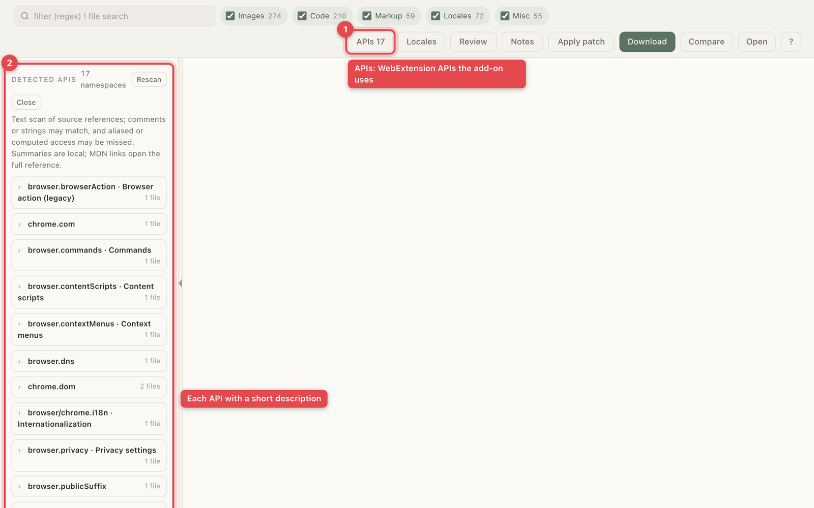

1. Click **APIs** at the top. The add-on's code is scanned for WebExtension APIs
   (`browser.*` and `chrome.*`).
2. Each API is listed with a short description and the files that use it.
   Descriptions come with the add-on and link to the full reference on MDN.

To find where an API is used, search for it with `!api:` in the filter box,
for example `!api:tabs.query`.

---

## 12. Review report

Click **Review** at the top for a report about the whole add-on.

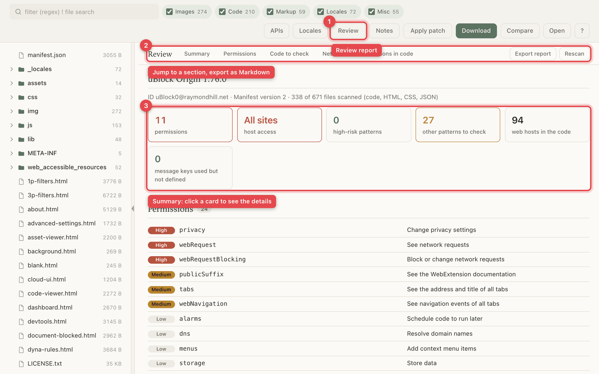

1. **Review** — opens the report (it takes a moment for large add-ons).
2. Jump to a section, **Export report** as Markdown, or **Rescan** after edits.
3. The summary: permissions, site access, risky code patterns, web addresses
   and translation keys. Click a card to see its details.

The sections:

- **Permissions** — each permission with what it allows and how much it matters
  (**High**, **Medium**, **Low**), site access, content scripts, the content
  security policy (with warnings for `unsafe-eval` and remote scripts),
  web-accessible resources.
- **Code to check** — see below.
- **Network** — every web address in the code, grouped by host. Some are only
  links or documentation.
- **Translations in code** — message keys that the code uses
  (`__MSG_name__`, `getMessage("name")`) but no `messages.json` defines (users
  would see an empty text), and keys that are defined but never mentioned in the code.

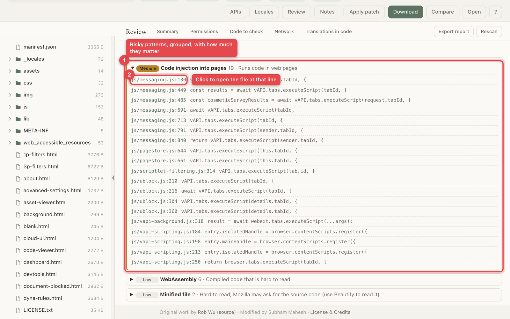

1. Risky patterns, grouped and sorted by how much they matter: `eval()`,
   `new Function()`, timers with strings, HTML from variables (`innerHTML`,
   `document.write`), remote scripts, code injection into pages, WebAssembly,
   minified and obfuscated files. Comments are ignored.
2. Click a place (`file:line`) to open the file at that line.

---

## 13. Review notes

Notes help you keep track of what to check or report. They are kept for this
browser session only: they survive reloading the tab, and are gone when you
close it. Export them to keep them.

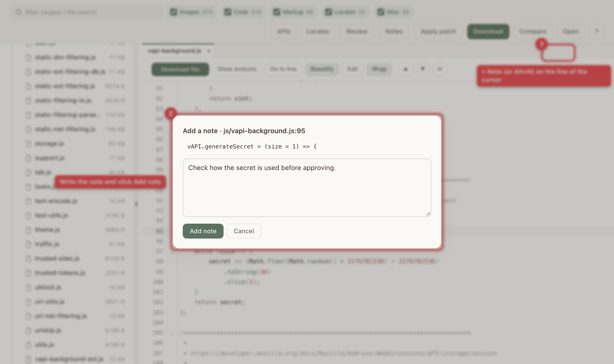

1. Put the cursor on a line and click **+ Note** (or press **Alt+N**).
2. Write the note and click **Add note**. A dot appears next to the line; click
   it to edit or delete the note.

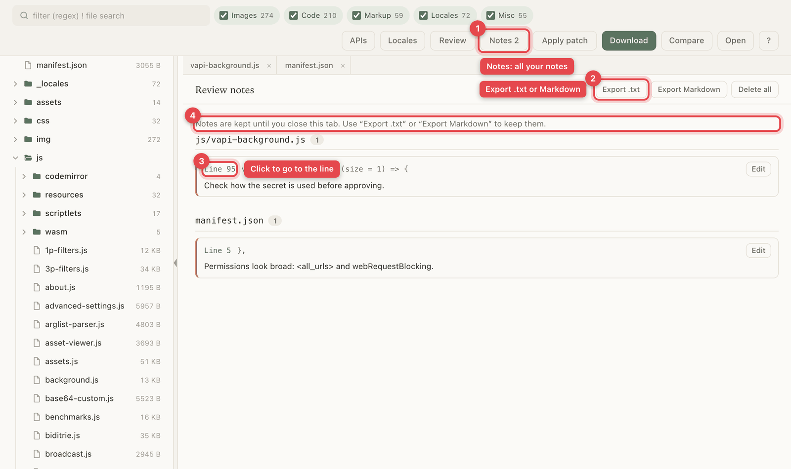

1. **Notes** at the top lists all notes, by file.
2. **Export .txt** downloads a text file with, for each note, the file, the
   line, the code of that line, when it was written and the note (plus the
   add-on file and its SHA-256). **Export Markdown** does the same as Markdown.
   **Delete all** removes them.
3. Click a line link to go to the note's line; **Edit** changes or deletes it.
4. A reminder that notes are kept until you close the tab.

Example of an exported `.txt`:

```
Review notes
============================================================
Add-on file: ublock_origin-1.76.0 (SHA-256 6f20ff67…)
Exported:    11/11/2026, 01:25:20
Notes:       2

============================================================
File: js/vapi-background.js (1 note)
============================================================

[1] Line 95  ·  11/11/2026, 01:24:02
    Code: vAPI.generateSecret = (size = 1) => {
    Check how the secret is used before approving.
```

---

## 14. Quick open, symbols and tabs

### Quick open

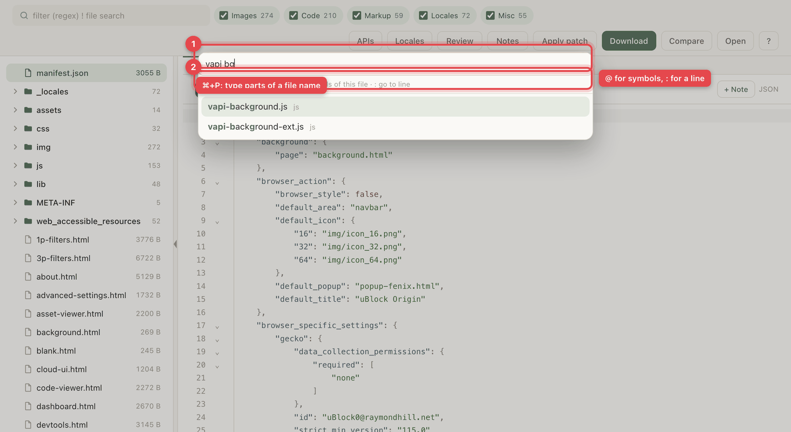

1. Press **Ctrl+P** (**⌘P**) and type parts of a file name, for example
   `vapi bg` for `vapi-background.js`. Use ↑ ↓ and **Enter** to open a file.
2. Start with **@** to go to a symbol of the shown file, or **:** to go to a
   line (for example `:120`).

### Go to symbol

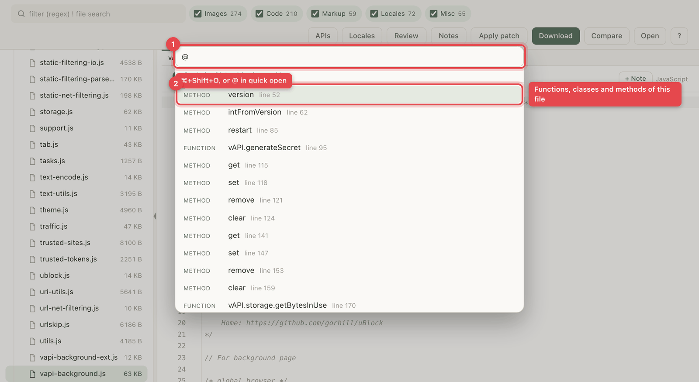

1. Press **Ctrl+Shift+O** (**⌘⇧O**), or type **@** in quick open.
2. The functions, classes and methods of a JavaScript file (or the selectors of
   CSS, the ids of HTML, the keys of JSON, the headings of Markdown). Type to
   filter, **Enter** to jump. For minified code, click **Beautify** first.

If Firefox uses **Ctrl+Shift+O** for its own window, use **@** in quick open.

### Tabs

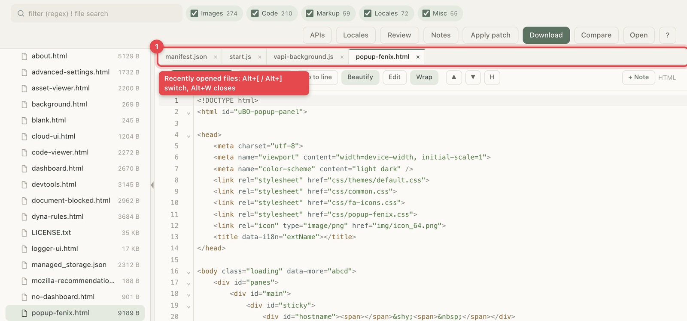

1. Files you open appear as tabs. Click a tab to switch, **×** (or a middle
   click) to close it. **Alt+[** and **Alt+]** switch to the previous / next
   tab, **Alt+W** closes the tab. Edited files show a dot.

---

## 15. Keyboard shortcuts

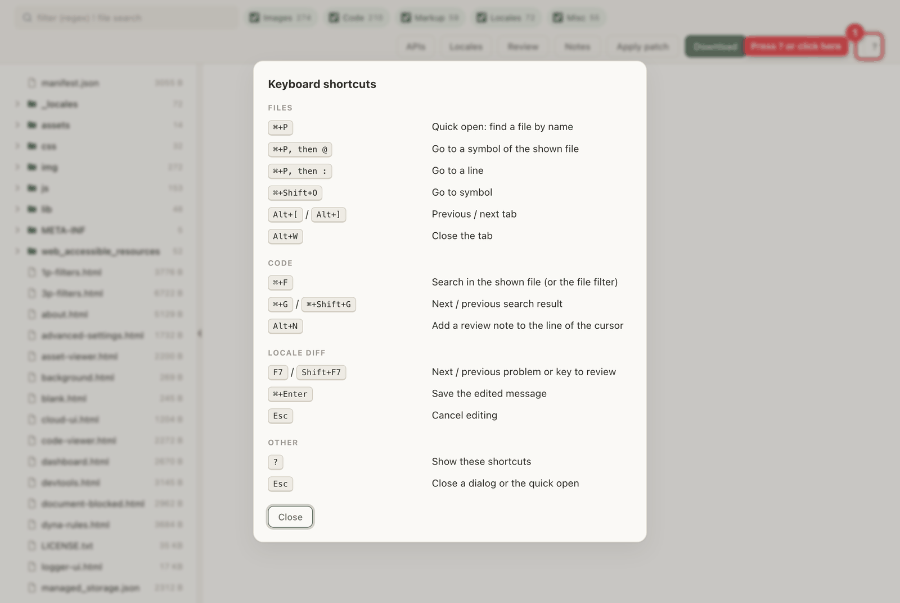

1. Press **?** (when you are not typing) or click **?** at the top to see all
   shortcuts.

| Shortcut | What it does |
|---|---|
| **Ctrl/⌘+P** | Quick open a file |
| **Ctrl/⌘+P**, then **@** / **:** | Go to a symbol / a line |
| **Ctrl/⌘+Shift+O** | Go to symbol |
| **Alt+[** / **Alt+]** | Previous / next tab |
| **Alt+W** | Close the tab |
| **Ctrl/⌘+F** | Search in the shown file (or the file filter) |
| **Ctrl/⌘+G** / **Ctrl/⌘+Shift+G** | Next / previous search result |
| **Alt+N** | Add a review note |
| **F2** | Rename the selected file |
| **F7** / **Shift+F7** | Next / previous difference in the locale diff |
| **Ctrl/⌘+Enter** | Save an edited message |
| **Esc** | Cancel, close a dialog or quick open |
| **?** | Show the shortcuts |

---

## 16. Settings

Open **Settings** from the popup (or about:addons → Zen Source Viewer → Options).

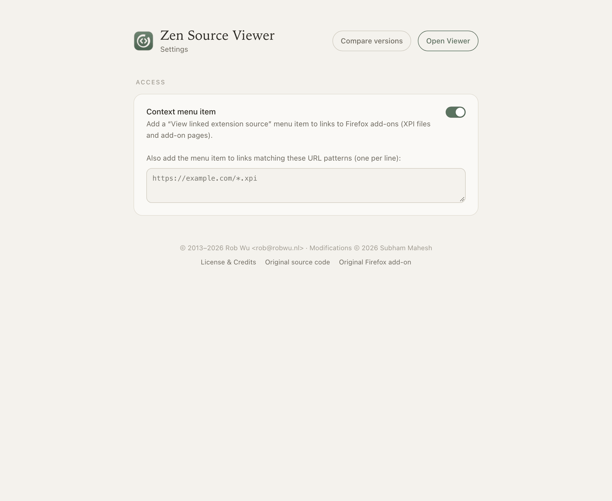

- **Context menu item** — show **View linked extension source** when you
  right-click a link to an add-on. Add your own URL patterns (one per line) to
  show it on other links too.
- **Privacy** — shows which version of the privacy policy you agreed to.
  **Withdraw consent** turns the add-on off until you agree again.

---

## 17. Privacy

Zen Source Viewer does not collect any data. It connects to a website only when
you ask it to fetch an add-on or file. Files you upload never leave your
computer. Review notes are kept only until you close the tab, and a few display
choices are saved in your browser.
See the [privacy policy](../PRIVACY.md) for details.

**Consent.** Before you can use the add-on, it shows the privacy policy and asks
you to agree. Until you agree, every page of the add-on (popup, viewer, Compare,
Settings) shows this consent page instead. If the policy changes, you are asked
again. The policy is also available from **Privacy Policy** in the popup, the
viewer and Settings.
